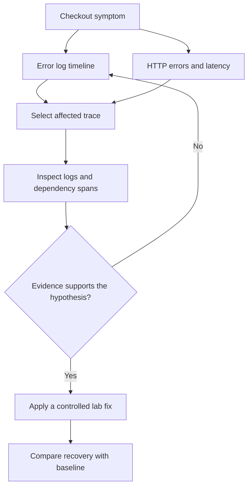

# Dynatrace DQL Examples for SREs: Errors, Latency and Log Analysis

**Author:** Praveen Veerapogu  
**Website:** [Veerpedia](https://www.veerpedia.com/)  
**Documentation reviewed:** 18 October 2026

When an application becomes slow, an SRE needs to answer three questions quickly: what is failing, which requests are affected, and what evidence explains the behaviour?

Dynatrace Query Language, or DQL, helps you investigate those questions using data in Grail. In this guide, we use ten practical queries to examine error logs, calculate an observed HTTP 5xx percentage, compare response-time percentiles, and connect logs with trace IDs.

The examples follow a fictional checkout service called `veerpedia-checkout`. This is a training scenario, not a description of Veerpedia's live website architecture. You can replace the service name and field mappings with values from your own application.

## What is Dynatrace DQL?

DQL processes data through a sequence of commands separated by a pipe, `|`. For example, a query can load logs, filter a service, count errors, and sort the result.

These are the main commands used in this article:

| Command | Purpose |
|---|---|
| `fetch` | Read stored data such as logs or spans. |
| `filter` | Keep records matching a condition. |
| `fields` | Select the fields to display. |
| `fieldsAdd` | Add a calculated or normalized field. |
| `summarize` | Calculate aggregates, optionally grouped by a field. |
| `makeTimeseries` | Turn records into a time series. |
| `sort` and `limit` | Order results and restrict displayed rows. |

These examples target the latest Dynatrace experience with Grail and Notebooks. They are not Classic dashboard metric-selector expressions. [1]

## Before running the queries

For live-data examples, you need access to Notebooks and permission to read the relevant logs and spans in Grail. An installed OneAgent alone does not guarantee that both datasets are available to your user.

Open **Notebooks**, create a notebook named **Veerpedia — DQL Incident Investigation**, add a **DQL/Query** section, paste a query, and select **Run**. Add one section per investigation question. Interface labels can vary slightly. [2]

The live examples explicitly query the last 30 minutes. The `from:` parameter in the query sets that window; changing only the notebook's time picker will not change it. To investigate an older incident, use its absolute start and end times, or remove the explicit bounds and use the notebook timeframe consistently.

First inspect a few records:

```dql
fetch logs, from: now() - 30m
| limit 5
```

```dql
fetch spans, from: now() - 30m
| filter span.kind == "server"
| limit 5
```

Inspect the raw record fields before copying filters. A field present in one ingestion pipeline may be absent in another.

| Field used here | What to verify in your tenant |
|---|---|
| `service.name` | The examples assume this string exists on relevant logs and spans. It is explicitly supplied in the demo. If your data uses `dt.entity.service` or another service field, replace the service filter and grouping with that actual field and value. Do not compare an entity ID with a display name. |
| `loglevel` and `content` | Confirm the severity values and message field used by your log pipeline. |
| `error.type` | Confirm that structured logs contain an error category. Otherwise emit or extract one, or use the text-search example. |
| `span.kind` | The HTTP examples select `server` spans for one application boundary. |
| `http.response.status_code` | Confirm this field is numeric. Older or custom pipelines may use a different field name or type. |
| `duration` and `start_time` | Span duration is a duration value; span time-series queries use `start_time`. |
| `trace.id` or `trace_id` | Confirm trace-context enrichment and the identifier representation on logs. |

**Compatibility note:** the current semantic dictionary marks `request.is_failed` and `request.is_root_span` as deprecated, with replacement transaction fields documented at experimental stability. The examples below use an explicit HTTP 5xx definition and stable span fields instead of assuming those request flags exist. [3]

## Ten DQL examples for an SRE investigation

### 1. Find recent error logs for the affected service

Start with the actual error messages before deciding which component is responsible.

```dql
fetch logs, from: now() - 30m
| filter service.name == "veerpedia-checkout"
| filter loglevel == "ERROR"
| sort timestamp desc
| limit 50
| fields timestamp, service.name, loglevel, content, trace_id, trace.id
```

This returns the latest matching log records. The result is a list of log messages, not a count of failed requests. If your ingestion uses other severity values, such as SEVERE, inspect them first and adjust the filter.

**Recommended visualization:** Table.

### 2. Identify which service produces the most error logs

Use this to narrow an incident across a group of related services.

```dql
fetch logs, from: now() - 30m
| filter startsWith(service.name, "veerpedia-")
| filter loglevel == "ERROR"
| summarize error_logs = count(), by: {service.name}
| sort error_logs desc
```

The prefix deliberately limits this example to the training services. Replace it with your application scope. A service producing many error logs deserves investigation, but high log volume alone does not establish business impact or root cause.

**Recommended visualization:** Bar chart or table.

### 3. Show when the error logs increased

A timeline helps you compare the incident with a deployment, configuration change, or dependency problem.

```dql
fetch logs, from: now() - 30m
| filter service.name == "veerpedia-checkout"
| filter loglevel == "ERROR"
| makeTimeseries error_logs = count(default: 0),
    time: timestamp,
    interval: 1m,
    from: now() - 30m,
    to: now(),
    nonempty: true
```

Each point represents matching error logs in a one-minute bucket. A zero means no matching records in that bucket; it does not prove that the service was healthy or that log collection was working.

**Recommended visualization:** Line chart.

### 4. Group errors into useful categories

Repeated categories are easier to act on than hundreds of messages containing different request IDs.

```dql
fetch logs, from: now() - 30m
| filter service.name == "veerpedia-checkout"
| filter loglevel == "ERROR"
| fieldsAdd error_category = coalesce(error.type, "unclassified")
| summarize error_logs = count(), by: {error_category}
| sort error_logs desc
```

This example assumes a populated error.type field. The demo supplies it explicitly. For live logs, emit structured error categories or extract a suitable field during processing. If the field is missing, the query reports unclassified. Avoid grouping a large dataset by entire messages containing unique IDs.

**Recommended visualization:** Bar chart.

### 5. Search for timeout messages

Use a targeted text search to investigate a hypothesis suggested by the error categories.

```dql
fetch logs, from: now() - 30m
| filter service.name == "veerpedia-checkout"
| filter contains(content, "timeout", caseSensitive: false)
| sort timestamp desc
| limit 50
| fields timestamp, loglevel, content, trace_id, trace.id
```

The case-insensitive substring search matches messages containing timeout. Change the text for a different investigation. Read the message in context: a timeout could originate in a dependency, a connection pool, a network path, or the application itself.

**Recommended visualization:** Table.

### 6. Calculate the HTTP 5xx percentage in observed server spans

Separate error-log volume from the proportion of captured HTTP operations returning a server error.

```dql
fetch spans, from: now() - 30m
| filter service.name == "veerpedia-checkout"
| filter span.kind == "server"
| filter isNotNull(http.response.status_code)
| summarize observed_http_spans = count(),
    http_5xx_spans = countIf(
      http.response.status_code >= 500 and
      http.response.status_code < 600
    )
| filter observed_http_spans > 0
| fieldsAdd http_5xx_percent =
    100.0 * http_5xx_spans / observed_http_spans
```

The denominator contains only the selected HTTP server spans with a recorded status code. The numerator contains statuses 500–599. This is an observed-span HTTP 5xx percentage, not Dynatrace's configurable service failure rate and not automatically a production availability SLI. Requests without a recorded status code are excluded. If there are no eligible spans, the query returns no result rather than claiming 0% errors.

**Recommended visualization:** Table with count and percentage.

**Sampling and scope matter:** stored spans can be sampled or aggregated, and multiple instrumented server boundaries can represent one user request. These examples do not apply extrapolation weights. Treat their counts, percentages, and latency distributions as diagnostics of the selected observed spans. For production SLOs or full-traffic reporting, use a validated metric or a correctly weighted calculation with a clearly defined request boundary. [4]

### 7. Compare average, P50, P95 and P99 latency by endpoint

Find endpoints whose slowest requests are hidden by a reasonable average.

```dql
fetch spans, from: now() - 30m
| filter service.name == "veerpedia-checkout"
| filter span.kind == "server"
| filter isNotNull(http.response.status_code)
| fieldsAdd endpoint = coalesce(endpoint.name, http.route, span.name)
| summarize observed_http_spans = count(),
    average_latency = avg(duration),
    p50_latency = percentile(duration, 50),
    p95_latency = percentile(duration, 95),
    p99_latency = percentile(duration, 99),
    by: {endpoint}
| sort p95_latency desc
```

P50 describes the middle of the observed distribution. P95 and P99 describe its slower tail. Keep the count beside the percentiles: small samples can produce unstable tail estimates. A slow successful request still affects user experience, so the query includes both successful and failed HTTP spans. Use normalized endpoint or route names rather than full URLs with customer IDs.

**Recommended visualization:** Table.

Span `duration` is a typed duration. Use literals such as `500ms` or `1s` for comparisons. Do not divide it by a guessed factor and label the result milliseconds. If another dataset stores a plain number, establish its unit before converting it. [5]

### 8. Plot average and P95 latency over time

Determine when performance changed and whether it recovered.

```dql
fetch spans, from: now() - 30m
| filter service.name == "veerpedia-checkout"
| filter span.kind == "server"
| filter isNotNull(http.response.status_code)
| makeTimeseries average_latency = avg(duration),
    p95_latency = percentile(duration, 95),
    time: start_time,
    interval: 1m,
    from: now() - 30m,
    to: now()
```

The query uses start_time for spans. Keep empty latency buckets empty: no request observation is not the same as a zero-millisecond response. Choose a larger interval when traffic is sparse. These percentiles describe the selected stored spans; sampling may change how well they represent all requests.

**Recommended visualization:** Line chart.

### 9. Find slow requests and copy a trace ID

Move from the chart to individual examples you can inspect.

```dql
fetch spans, from: now() - 30m
| filter service.name == "veerpedia-checkout"
| filter span.kind == "server"
| filter isNotNull(http.response.status_code)
| filter duration > 1s
| sort duration desc
| limit 20
| fields start_time, service.name, endpoint.name,
    duration, http.response.status_code, trace.id
```

The one-second threshold is an example, not a universal target. Replace it with a threshold meaningful to the application. Use the returned trace ID to inspect the corresponding distributed trace in live data. The synthetic demo does not create a trace in Dynatrace's distributed tracing application.

**Recommended visualization:** Table.

### 10. Find logs belonging to the selected trace

Connect a slow or failed request with its related messages.

```dql
fetch logs, from: now() - 30m
| fieldsAdd correlation_id = coalesce(
    toString(trace.id),
    toString(trace_id)
  )
| filter correlation_id == "00000000000000000000000000000006"
| sort timestamp asc
| fields timestamp, service.name, loglevel, content, correlation_id
```

Replace the example ID with a value returned by query 09. The query covers the trace.id and trace_id naming patterns; inspect your actual fields before applying it. Logs require trace-context enrichment for this correlation to work. A matching trace links evidence to an operation, but a matching message alone does not prove the underlying cause.

**Recommended visualization:** Table in chronological order.

For a live investigation, inspect the trace's child spans, dependency timing, and relevant configuration or change events before selecting a fix. If the trace is unavailable, check retention, sampling, and the analysis window. [4]

The aggregation examples use `summarize` for tables and `makeTimeseries` for charts. The text-search example uses the documented case-sensitivity parameter. [6][7]

## Demonstrate the investigation as a short incident story

A useful demonstration connects each query to a decision. Use the scenario: **“Checkout requests became slow, some returned 5xx responses, and we need to identify the affected operation.”**

Use this investigation flow:



### Option A: Rehearse with synthetic DQL data

The companion demo pack contains a `demo` folder. Each file is a complete query beginning with `data record(...)`, followed by the same investigation pipeline used in this article. No application deployment or telemetry ingestion is needed. You still need a Dynatrace context where you can execute DQL.

The `data` command creates records only during query execution. It does not write them into Grail, create a real service, populate Distributed Tracing, or trigger monitoring alerts. Dynatrace documents it for small test and documentation scenarios. [8]

1. Open `demo/00-inspect-spans.dql` and copy the entire file into a Notebook query section.
2. Run it and inspect the supplied fields.
3. Add the queries for error trend, HTTP 5xx percentage, endpoint latency, slow spans, and trace-linked logs.
4. Keep the same 30-minute view. The sample timestamps are relative to `now()`, so the data remains recent when you rehearse.
5. Finish with `demo/11-compare-synthetic-phases.dql`.

The fixture contains 14 synthetic HTTP server spans and 15 synthetic log records, including a small catalog service. The checkout subset has the following intentionally designed phases:

| Synthetic phase | Checkout spans | HTTP 5xx spans | HTTP 5xx percentage | Average latency |
|---|---:|---:|---:|---:|
| Baseline | 4 | 0 | 0% | 150 ms |
| Incident | 4 | 3 | 75% | 2,000 ms |
| Recovery | 4 | 0 | 0% | 160 ms |

These are teaching values, not measured production results. The complete checkout sample contains 12 spans and 3 HTTP 5xx responses: an observed 25% HTTP 5xx percentage across all three phases.

It also contains **four ERROR log messages for three failed HTTP spans**, because one failed request emits two messages. Use this to explain why error-log count and failed-request count are different.

One-minute latency buckets contain very few observations in this fixture. They illustrate query behaviour; use larger real samples before interpreting P95 or P99 statistically. The synthetic recovery rows represent a designed scenario, not proof that a real fix was applied.

### Option B: Record a live lab demonstration

Use a non-production application you control, such as an instrumented demo API or an existing EasyTravel lab. Replace the example service name, endpoint, status-code mapping, and trace fields with the values you actually observe.

1. **Check telemetry first.** Confirm the application produces queryable logs and spans, and that its logs include trace context. Record the service, runtime, instrumentation version, and capture settings.
2. **Capture a baseline.** Run a repeatable, low-volume request sequence and record the exact time window and request count.
3. **Introduce one reversible fault.** Use a test-only application switch or a mock dependency to add latency and return some 5xx responses. Keep the request pattern comparable. If your demo app has no fault control, add or configure one before recording.
4. **Record the incident window.** Capture errors, the status-code breakdown, and latency. Ensure telemetry ingestion has caught up.
5. **Investigate with the queries.** Follow the sequence from the timeline to slow spans and trace-linked logs. Open the actual distributed trace to inspect where time was spent.
6. **Remove the lab fault.** Repeat the same traffic sequence and compare a separate recovery window with the baseline.
7. **Document what was confirmed.** Explain the injected cause, the evidence that detected it, the remediation, and any remaining uncertainty.

For a first recording, an application delay and controlled 5xx response are sufficient. A database or payment-dependency explanation requires corresponding dependency evidence; do not present an injected sleep as proof of database contention.

### Suggested recording sequence

| Recording time | Show | Explain |
|---|---|---|
| 0:00–0:45 | Scenario and query scope | The symptom, service, timeframe, and whether data is synthetic or live. |
| 0:45–1:30 | Raw record fields | Why field discovery comes before copying a query. |
| 1:30–2:30 | Queries 01 and 03 | What failed and when error messages increased. |
| 2:30–3:30 | Query 06 | Why the observed 5xx percentage differs from log counts. |
| 3:30–4:30 | Queries 07 and 08 | How latency changed and why sample count matters. |
| 4:30–6:00 | Queries 09 and 10 | How a trace ID connects the request with relevant logs. |
| 6:00–7:00 | Phase comparison or real recovery window | What improved and which evidence supports that conclusion. |

For the blog, use six focused screenshots: field discovery, error timeline, HTTP counts and percentage, latency results, trace-linked logs, and the recovery comparison. Keep the service and timeframe visible. Label synthetic screenshots clearly and hide tokens, personal data, and unrelated tenant information.

If your publishing platform does not render Mermaid, export the diagram as an image and add a short caption explaining the investigation flow.

## Common problems and how to resolve them

| Symptom | What to check |
|---|---|
| No log or span records | Timeframe, ingestion, retention, permissions, and whether this data is available in Grail. |
| Data appears before the service filter, then disappears | The service field, exact value, and whether you are comparing a name with an entity ID. |
| HTTP filters return no rows | Numeric status-code field, actual field name, and span kind. Add filters one at a time. |
| All errors appear as unclassified | The structured `error.type` field has not been supplied or extracted. |
| A time chart is empty | The correct timestamp field and matching time bounds. Use `start_time` for spans. |
| Trace correlation returns no logs | Trace enrichment, exact identifier, naming convention, time window, and ingestion delay. |
| Percentiles look extreme | Small samples, mixed endpoints, sampling bias, outliers, or a genuine tail-latency problem. |
| Results differ from the service screen | Request scope, failure-detection rules, timeframe, filters, sampling, aggregation, or different data sources. |

To keep investigations efficient, use a narrow timeframe and relevant scope, display only useful fields, and inspect any query warnings or scan-limit messages. A `limit` at the end restricts returned rows; it does not necessarily avoid scanning the underlying records. Expand the search deliberately when the initial scope is insufficient. [9]

## Frequently asked questions

### Can I use these queries without production data?

Yes. The companion `demo` queries generate sample records at query time. They are useful for learning and rehearsing, but do not test a real instrumentation or ingestion pipeline.

### Is an ERROR log the same as a failed request?

No. One request can generate several error logs, and a failed request may generate none. Use logs to investigate events and a clearly defined request dataset or metric to measure a failure percentage.

### Why use P95 when average response time is available?

An average can hide a smaller group of slow requests. P95 helps you inspect that slower tail. Interpret it alongside traffic count, endpoint scope, and the sampling behaviour of the data.

### Why do logs not appear when I search using a trace ID?

The application or logging integration must attach trace context, and the ingestion pipeline must preserve it. DQL cannot reconstruct missing trace IDs from unrelated messages.

### Can this observed 5xx percentage be used directly as an SLO?

Only after validating the request boundary, denominator, capture completeness, and sampling or aggregation handling. It is an investigation query in this guide, not a ready-made production availability definition.

## Conclusion

DQL is most useful when every query answers an operational question. Start with the symptom, establish the affected service and timeframe, inspect HTTP errors and latency, and connect individual traces with their logs. Validate the suspected cause, then compare recovery against a meaningful baseline.

For a broader implementation approach, see [How to Implement Observability and APM](https://www.veerpedia.com/2026/10/how-to-implement-observability-apm.html). For related log-alerting practice, see [How to Set Up Alerts for AccessDeniedException Logs in Dynatrace](https://www.veerpedia.com/2025/07/DynatraceLogMonitoringAlert.html).

## Official references

1. [Dynatrace Query Language](https://docs.dynatrace.com/docs/platform/grail/dynatrace-query-language)
2. [Dynatrace Notebooks](https://docs.dynatrace.com/docs/analyze-explore-automate/dashboards-and-notebooks/notebooks)
3. [Semantic Dictionary: Traces](https://docs.dynatrace.com/docs/semantic-dictionary/model/trace)
4. [Advanced Tracing Analytics](https://docs.dynatrace.com/docs/observe/application-observability/distributed-tracing/advanced-tracing-analytics)
5. [DQL data types](https://docs.dynatrace.com/docs/platform/grail/dynatrace-query-language/data-types)
6. [DQL aggregation commands](https://docs.dynatrace.com/docs/platform/grail/dynatrace-query-language/commands/aggregation-commands)
7. [DQL string functions](https://docs.dynatrace.com/docs/platform/grail/dynatrace-query-language/functions/string-functions)
8. [DQL data source commands](https://docs.dynatrace.com/docs/platform/grail/dynatrace-query-language/commands/data-source-commands)
9. [DQL best practices](https://docs.dynatrace.com/docs/platform/grail/dynatrace-query-language/dql-best-practices)
10. [DQL conversion and casting functions](https://docs.dynatrace.com/docs/platform/grail/dynatrace-query-language/functions/conversion-and-casting-functions)

---

## Publishing metadata

- **SEO title:** Dynatrace DQL Examples for SREs: Errors, Latency and Log Analysis
- **Suggested URL slug:** `dynatrace-dql-examples-sre-errors-latency-logs`
- **Meta description:** Learn practical Dynatrace DQL queries to investigate error logs, HTTP 5xx responses and latency, with a step-by-step SRE demo and trace correlation.
- **Primary phrase:** Dynatrace DQL examples
- **Supporting phrases:** Dynatrace log analysis, DQL latency queries, Dynatrace trace correlation, DQL for SRE
- **Suggested labels:** Dynatrace, DQL, SRE, Observability, APM, Log Analysis
- **Featured-image text:** Dynatrace DQL for SREs — Errors, Latency & Logs

The publishing metadata is for your editor settings and can be removed from the article body. Attach the companion demo ZIP or publish its files at a download location before referring readers to it. Add screenshots from your own verified run.
