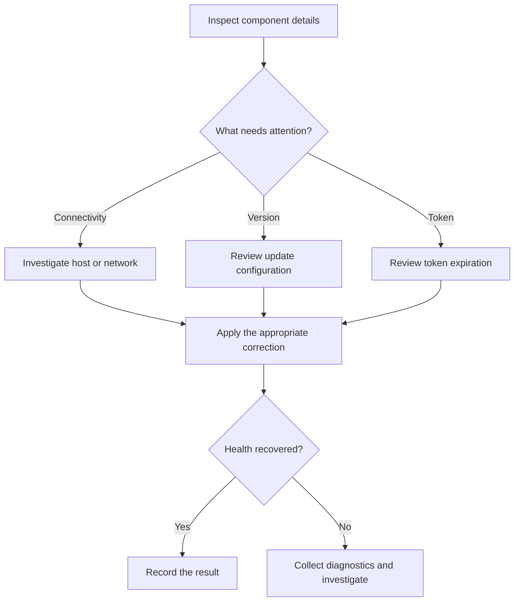
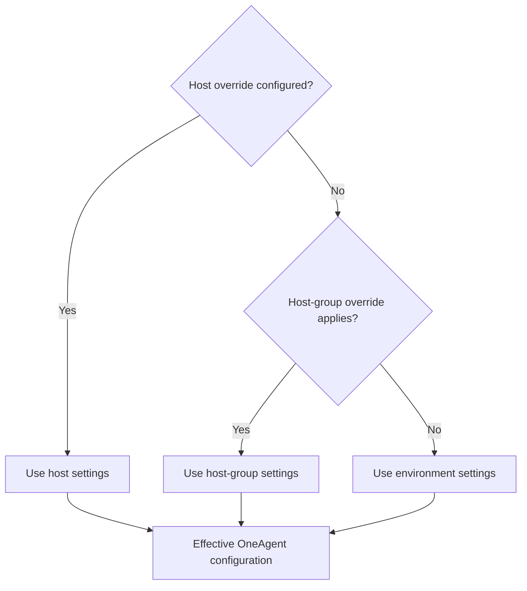
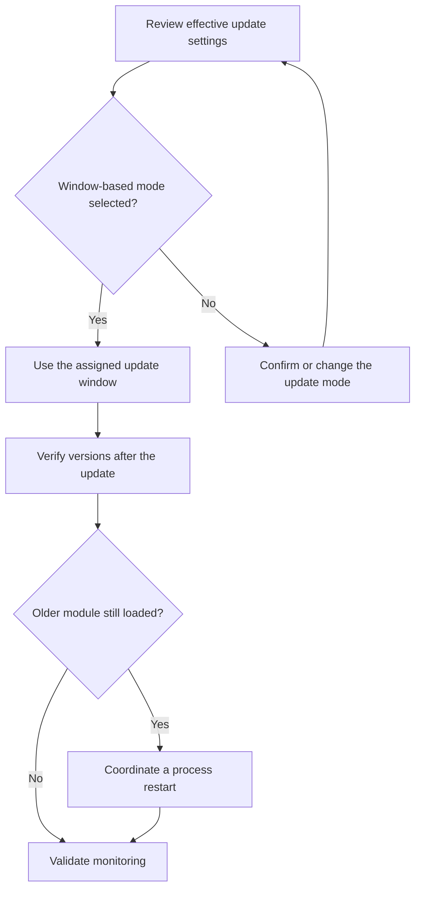
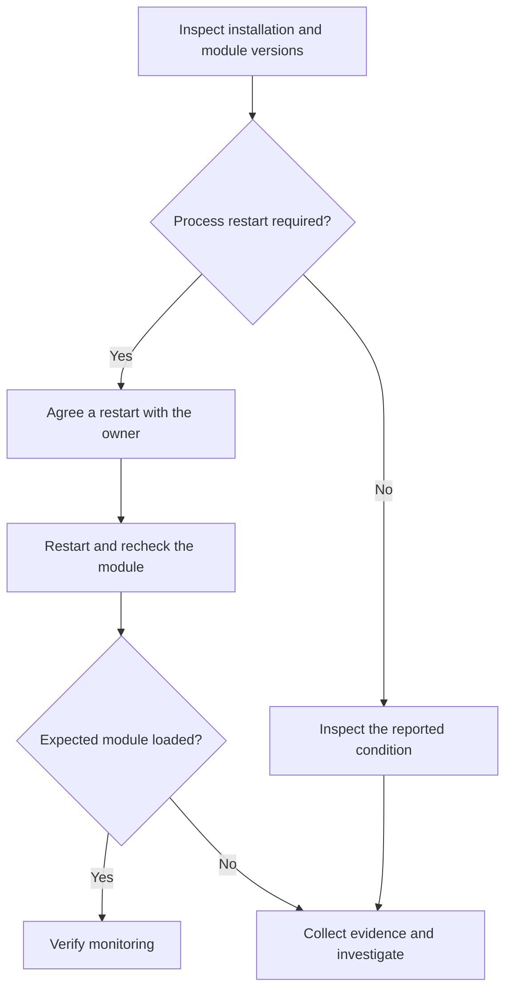

# Dynatrace Fleet Management: Capabilities, Classic Comparison and SRE Use Cases

**Author: Praveen Veerapogu | Veerpedia**  
**Reviewed: 19 October 2026**

Reliable monitoring depends on the components that collect and forward its data. During daily operations, an SRE may need to investigate a disconnected agent, review a version mismatch, or arrange an update with an application team.

Dynatrace Fleet Management brings these component-management tasks into a common workspace. This guide explains its capabilities, compares them with existing Classic features, and describes four practical operational scenarios using official documentation and the supplied screenshots.

## 1. What is Fleet Management and what are its capabilities?

### What does “fleet” mean?

Fleet Management is the Dynatrace app for centrally inspecting and administering monitoring components. Its documented inventory currently covers **OneAgent modules and ActiveGates**. [1]

- **OneAgent modules:** The supplied example shows separate OS and Log Analytics module entries associated with the same host. A module count should not be interpreted as a host count.
- **ActiveGates:** Depending on their purpose, these can route monitoring traffic, monitor supported cloud or remote technologies, run private Synthetic monitors, or provide zRemote functionality. Available functions depend on purpose and deployment type. [3]

The SaaS 1.343 release notes describe Fleet Management as a central experience for component health, troubleshooting, installation, updates and configuration. [2]

### Main capabilities

- **Deployment visibility:** Inspect component health and deployment information together. ActiveGate views are organized around purpose, including ActiveGate, Synthetic Engine and zRemote. [2]
- **OneAgent health checks:** Identify communication problems, aging or incompatible versions, and processes that need a restart. The OneAgent reference also documents a Disconnected condition. [8]
- **ActiveGate health checks:** Review connectivity loss, expiring tokens, unsupported versions and intentional shutdowns. The default list order puts critical conditions before warnings. [9]
- **Version control:** Select a rolling OneAgent target, such as latest or previous, or pin a version. The target answers which version to use. [7]
- **Update scheduling:** Choose automatic updating without a scheduled window, automatic updating during a window, or disabled automatic updating. The mode answers when updating is allowed. [7]
- **Configuration context:** The screenshots expose installed versions, target version, inherited configuration scope, network zone and monitoring mode.
- **Installation guidance:** Generate a download token and obtain commands to run on the target system. The documented generated platform token lasts 24 hours. [1]
- **Diagnostic collection:** The screenshots show a Support Archive menu. OneAgent diagnostics can supply configuration, logs and host or process context for investigation. [10]
- **Network-zone administration:** Access network-zone settings from the app. Network zones organize routing, with alternative zones and fallback choices. [1][11]
- **Data exploration:** Fleet data is stored in Grail and is available through DQL, Notebooks and ready-made dashboards. [1]

### How an SRE uses the app

Open an inventory entry, inspect its condition and configuration, and follow the relevant documented action. The flow below summarizes an operator's investigation; it does not describe an internal network architecture. The branches reflect OneAgent and ActiveGate health guidance. [8][9]

Corrective changes and recording results are operator activities; the diagram does not imply automatic remediation.

### What the supplied screenshots demonstrate

- The inventory contains `host` and `oneagentloganalytics.exe`, both associated with the same visible host and both reporting Healthy.
- The module version is `1.347`; the displayed installer build is `1.347.62.20261019-084101`.
- The target is latest, the configuration is inherited from the environment, and the displayed automatic mode updates when Dynatrace releases a version.
- The update menu offers environment, host-group and host scopes.
- The Support Archive menu presents a collection action. The screenshot does not show a completed collection.
- The update-window list is empty. This is compatible with the displayed automatic mode, which does not wait for a scheduled window.

These are observations of one captured environment. They do not establish the configuration or health of other hosts.

## 2. Fleet Management versus Deployment Status and other Classic features

**Dynatrace already supported centralized administration before Fleet Management.** Deployment Status was an existing entry point for inventory and remote configuration. OneAgent automatic updates, target versions and update windows were also documented Classic capabilities. [4][5]

### Deployment inventory

- **Deployment Status:** Administrators could inspect installed OneAgents and ActiveGates. [4][6]
- **Fleet Management:** Component details and health information are brought together in the newer app, with purpose-oriented ActiveGate views. [2]

### OneAgent update settings

- **Classic:** Settings > Updates > OneAgent updates provided automatic-update options, target versions and windows. Host-group and host settings could override broader settings. [4]
- **Fleet Management:** Version information and configuration links are available in component details, with settings under Settings > Fleet management > OneAgent version and updates. [7]

The inheritance principle remains relevant:

This diagram summarizes the documented OneAgent precedence rules. [4]

### ActiveGate updates

- **Classic:** Automatic and one-click updating were available. [6]
- **Newer controls:** SaaS 1.343 introduced Environment ActiveGate target-version and window controls aligned with OneAgent, including per-ActiveGate overrides. [2]

### Bulk configuration

- **Classic:** Deployment Status and APIs could remotely change OneAgent host groups, network zones, tags and properties, and ActiveGate groups or network zones. [5]
- **Fleet Management:** The release notes describe centralized settings in the new app. That statement does not establish that every Classic bulk operation has identical availability in every Fleet view. [2]

### Diagnostics and network zones

- **Classic diagnostics:** Hosts Classic and process pages offered OneAgent diagnostics, while command-line collection was available for a subset of diagnostic data. [10]
- **Fleet entry point:** The supplied screenshots place the Support Archive action in the selected module's details.
- **Network zones:** These already existed in Classic, including alternative zones and routing fallback. Fleet Management adds an access point to their administration. [11][1]

The distinction is a more unified administration experience plus documented additions such as ActiveGate scheduling controls. These sources do not justify claiming that all Classic pages are retired or that every management operation is new.

## 3. Four SRE use cases in daily Dynatrace operations

The following are **illustrative operational scenarios**, not incidents reported by the supplied screenshots. Approval, change records and post-change validation are suggested team practices, rather than built-in Fleet Management approval workflows.

### Use case 1: Scheduling production OneAgent updates

**Situation:** An application team permits agent updates only during an agreed change period.

- Inspect the installed version and effective update configuration.
- Confirm which scope should own the setting: environment, host group or host.
- Select an appropriate target and window-based automatic updating. [7]
- Arrange any application restart separately with the application owner.
- After the update, verify both installation and module versions. Injected modules can remain on their previous version until their processes restart. [12]

**Operational value:** The team can control update timing while checking whether application processes actually loaded the new module.

The diagram combines documented update behavior with suggested coordination and verification steps. [7][12]

### Use case 2: Investigating missing monitoring data

**Situation:** Fresh monitoring data is missing, and the SRE needs to determine whether a component has stopped reporting.

- Find the affected OneAgent module and inspect the reported health condition.
- A heartbeat overdue by 180 seconds can indicate communication problems or an unexpectedly exited process. An agent absent for more than five minutes is documented as Disconnected. [8]
- Check host reachability and the relevant process or communication path.
- If the cause remains unclear, collect diagnostic evidence for investigation or a support case. [10]
- After correcting the identified issue, recheck reporting and document the result.

**Operational value:** The investigation starts with evidence about the monitoring component. Missing telemetry alone does not prove that the application is unavailable.

### Use case 3: Acting on an expiring ActiveGate token

**Situation:** An ActiveGate is connected, but Fleet Management reports that its token is approaching expiry.

- Open the ActiveGate details and inspect the token warning.
- Review the remaining time shown and arrange token rotation using the ActiveGate security procedure linked from the health reference.
- After rotation, check connectivity and whether the warning clears.
- If connectivity remains impaired, continue investigating rather than assuming the rotation resolved everything.

The documented consequence is loss of connection when the token expires; the documented corrective action is token rotation. [9]

**Operational value:** Administrators can address the credential issue before expiry interrupts the connection. Identifying a warning is distinct from rotating the token.

### Use case 4: Resolving an outdated module after an agent update

**Situation:** OneAgent has been upgraded, but a monitored process still reports an older module.

- Compare the installed version with the selected module's version.
- Check for a process-restart recommendation. [8]
- Coordinate the affected process restart with its application owner.
- After restart, verify the module version and monitoring state.

OneAgent components injected into processes such as Java, .NET, Apache or IIS can retain their previous version until the process restarts. Monitoring continues with that earlier module beforehand. [12]

**Operational value:** Engineers can distinguish an updated installation from a process that has not yet loaded its newer module.

The approval and verification steps are suggested operating practice; the module-restart behavior is documented. [12]

## 4. Limitations and operational boundaries

- **New agents may not appear immediately.** The OneAgent health reference documents a 10–15 minute delay for newly connected agents. [8]
- **Serverless modules are excluded from this view.** The same reference says serverless OneAgent modules, including AWS Lambda, are not shown. [8]
- **ActiveGate update support depends on deployment type.** Automatic and one-click updating are limited to host-based installer deployments. Containerized ActiveGates use platform-specific deployment tooling. [6]
- **Selecting an older OneAgent target does not downgrade it.** Version targeting is not an automatic rollback mechanism. [7]
- **An installation update may still need process restarts.** Updating OneAgent does not immediately replace modules already loaded in monitored processes. [12]
- **Permissions govern administration.** The default Admin User policy includes required app permissions. Use the documented permission list for access configuration; network-zone editing requires appropriate permissions. [1]
- **Multi-environment archive access has a boundary.** An ActiveGate support archive can be downloaded only through its main environment. [1]
- **Query charging statements have a defined scope.** Dynatrace describes app browsing and ready-made dashboards as using zero-rated queries. Do not extend that statement to all custom DQL usage. [1]
- **Classic remote configuration has separate restrictions.** Its documentation excludes Operator-deployed OneAgents, application-only OneAgents, Solaris OneAgents and containerized ActiveGates. These are limits of that particular feature, not a blanket list of components invisible in Fleet Management. [5]

The supplied screenshots also illustrate an interpretation boundary: two healthy module rows do not prove that an entire application is healthy, and an empty update-window list does not prove that automatic updating is disabled. Read the selected component's health, version and effective configuration together.

## 5. Official Dynatrace reference documents

The article uses official Dynatrace documentation for product behavior and the supplied screenshots for the example. Diagrams are original explanatory summaries of those documented workflows.

1. [Fleet Management](https://docs.dynatrace.com/docs/ingest-from/fleet-management)
2. [What's new in Dynatrace SaaS 1.343](https://docs.dynatrace.com/docs/whats-new/saas/sprint-343)
3. [ActiveGate purposes and functionality](https://docs.dynatrace.com/docs/ingest-from/dynatrace-activegate/capabilities)
4. [Update OneAgent on Windows — Dynatrace Classic](https://docs.dynatrace.com/docs/ingest-from/dynatrace-oneagent-classic/installation-and-operation/windows/operation/update-oneagent-on-windows-classic)
5. [Remote configuration management of OneAgents and ActiveGates](https://docs.dynatrace.com/docs/ingest-from/bulk-configuration)
6. [Update ActiveGate](https://docs.dynatrace.com/docs/ingest-from/dynatrace-activegate/operation/update-activegate)
7. [Update OneAgent on AIX — shared version and update controls](https://docs.dynatrace.com/docs/ingest-from/dynatrace-oneagent/installation-and-operation/aix/operation/update-oneagent-on-aix)
8. [OneAgent health overview](https://docs.dynatrace.com/docs/ingest-from/fleet-management/oneagent-health-overview)
9. [ActiveGate health overview](https://docs.dynatrace.com/docs/ingest-from/fleet-management/activegate-health-overview)
10. [OneAgent diagnostics](https://docs.dynatrace.com/docs/ingest-from/dynatrace-oneagent/oneagent-troubleshooting/oneagent-diagnostics)
11. [Get started with network zones](https://docs.dynatrace.com/docs/manage/network-zones/network-zones-basic-info)
12. [OneAgent update](https://docs.dynatrace.com/docs/ingest-from/dynatrace-oneagent/oneagent-update)

