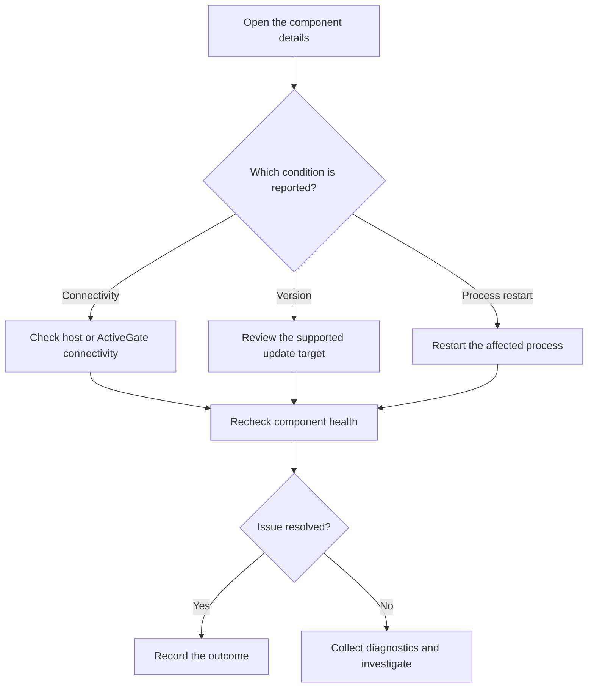
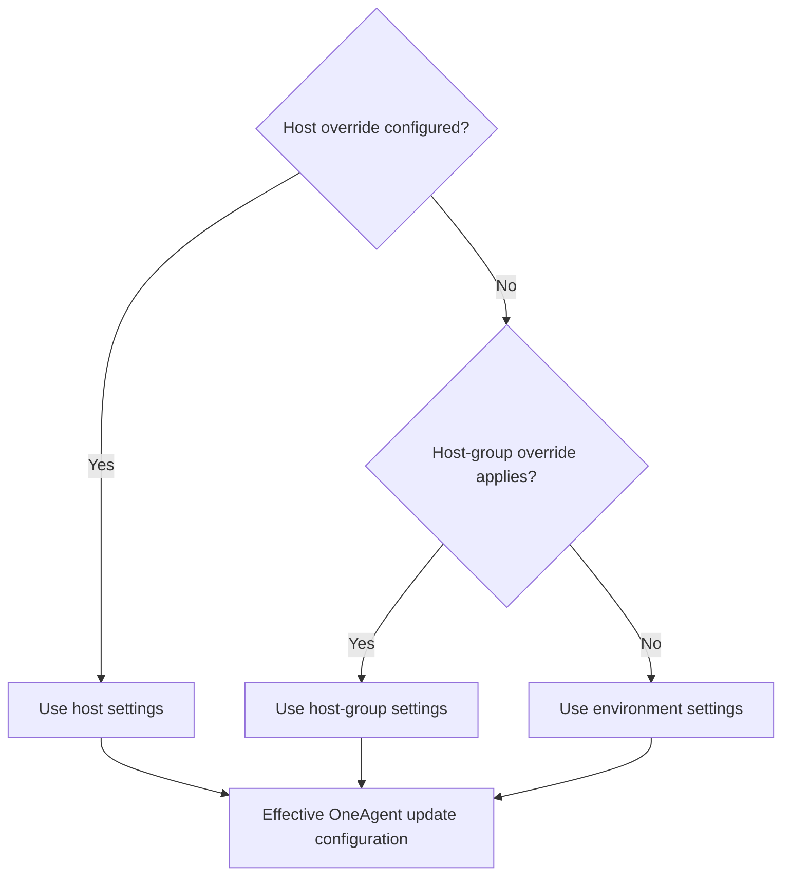
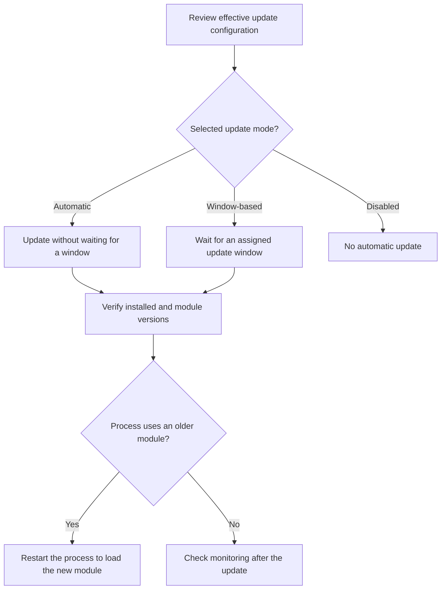

# Dynatrace Fleet Management Explained: Capabilities, Updates and How It Works

**Author: Praveen Veerapogu | Veerpedia**  
**Reviewed: 19 October 2026**

When a monitoring component stops reporting, runs an unsupported version, or needs a process restart, engineers need to understand the collection problem before relying on its monitoring data. Dynatrace Fleet Management brings component health and administration into a common workspace.

This guide explains the documented capabilities and uses six supplied screenshots to walk through a real OneAgent module view. Screenshot observations describe that environment at capture time; they are not product-wide defaults.

## 1. What is Fleet Management in Dynatrace?

Fleet Management is an app for administering Dynatrace monitoring components. It brings together deployment visibility, health information, troubleshooting, installation and update controls. Dynatrace introduced it in the SaaS 1.343 release notes as a central workspace for administrators. [2]

The overview currently lists **OneAgent modules and ActiveGates**. It does not establish identical management support for every telemetry integration. [1]

An ActiveGate can route OneAgent traffic, monitor supported cloud or remote technologies, run private Synthetic monitors, or support z/OS monitoring through zRemote. These are purpose-specific deployments; the available functionality depends on the purpose, platform and deployment type. [3]

Fleet Management therefore helps answer practical questions: Which component needs attention? What is installed? Which update settings apply? What action does the health condition recommend?

## 2. How were these tasks handled before Fleet Management?

Dynatrace already had central administration and automation. Fleet Management builds on that foundation; it did not introduce automatic OneAgent updates for the first time.

| Task | Documented Classic or existing approach | Fleet Management experience |
| --- | --- | --- |
| Inspect deployments | Deployment Status contained OneAgent and ActiveGate inventories. [4][6] | Component and purpose-oriented views bring deployment and health information together. [2] |
| Control OneAgent versions | Settings > Updates > OneAgent updates supported target versions, automatic updates and update windows. [4] | Update configuration is reached through the component details and the Fleet management settings category. [7] |
| Update ActiveGates | Classic supported automatic updates and a one-click update option. [6] | Target versions and scheduled update windows are available for supported deployments. [2][6] |
| Change multiple configurations | Remote configuration management worked through Deployment Status or APIs. [5] | Central settings and component context sit within the newer app experience. [2] |
| Investigate OneAgent issues | Hosts Classic and process pages offered OneAgent diagnostics; command-line collection was also available. [10] | The supplied screenshots show a Support Archive action directly in module details. |

The older bulk configuration workflow could change OneAgent host groups, network zones, tags and properties, and ActiveGate groups or network zones. Its deployment and version restrictions still matter; the existence of Fleet Management should not be read as removing them. [5]

A specific addition highlighted in the 1.343 release notes is more flexible Environment ActiveGate version and scheduling control, including per-ActiveGate overrides. [2]

## 3. How does Fleet Management work?

From an administrator's perspective, the sequence is to inspect a component, understand its reported condition, and use the relevant action or settings. The diagram below describes that operational workflow, not an internal telemetry transport architecture. Its branches are based on the documented OneAgent and ActiveGate health conditions. [8][9]

Recording the outcome is an operational recommendation for the reader, not an automatic Fleet Management action.

Fleet data is stored in Grail and is DQL-queryable, with Notebooks and ready-made dashboard access. Browsing the app and its ready-made dashboards uses zero-rated queries; this statement does not cover every custom query. [1]

## 4. What capabilities does Fleet Management provide?

### Component inventory and configuration context

The supplied inventory shows module names, module versions, health, module types and host links. Opening a row exposes status, version information and general configuration. The screenshots also show filtering, a time selector, refresh and optional columns.

This lets a reader move from a list entry to the details behind it. In the supplied example, the visible configuration includes the network zone and, in one screenshot, the Full-stack monitoring mode.

### OneAgent health and recommended actions

The OneAgent health reference identifies concrete conditions and responses. Examples include: [8]

| Condition | Documented state | Response |
| --- | --- | --- |
| Installer is more than 11 months old | Critical | Upgrade to preserve full support. |
| Module heartbeat is 180 seconds overdue | Critical | Investigate communication or an unexpectedly stopped process. |
| Installer is 9–11 months old | Warning | Plan an upgrade. |
| A process still uses an older module | Info | Restart the process to load the newer module. |
| Agent has not reported for over 5 minutes | Disconnected | Check host availability and reachability. |

The last row comes from the component-specific reference, which explicitly lists **Disconnected**. Health information should be interpreted in the context of the selected component.

### ActiveGate health

ActiveGate health includes lost connectivity, expiring tokens, unsupported versions and intentional shutdowns. A token approaching expiry requires rotation; an unsupported version requires an update. An intentional shutdown can appear as informational when the selected time range includes it. [9]

By default, the list prioritizes critical conditions, then warnings, then the remaining ActiveGates with older versions first. A custom filter or sort changes that ordering. [9]

### Version and update management

Two settings answer different questions: **target version** defines which release to use, while **update mode** defines when automatic updating is allowed. OneAgent supports rolling targets such as the latest or previous version, as well as a pinned version. Its environment target also applies to new deployments. [7]

The documented update modes are automatic updating when a release becomes available, automatic updating during configured windows, and disabled automatic updating. Selecting an older target does not downgrade an already newer OneAgent. [7]

For ActiveGate, automatic and one-click updating apply to host-based installer deployments. Containerized deployments use their platform's deployment tooling instead. [6]

### Installation guidance

Installation guidance supplies a download token and commands to run on the target system. OneAgent choices include mode and operating system; ActiveGate choices include purpose and deployment type. Generated platform tokens are valid for 24 hours. [1]

### Support archives

The screenshot offers **Collect support archive** for diagnostic evidence. A multi-environment ActiveGate's archive is downloadable through its main environment. [1]

Existing OneAgent diagnostics can also collect host or process information and OneAgent logs. Diagnostic collection and downloading evidence are distinct from resolving the underlying issue. [10]

### Network zones and access

Fleet Management provides access to network-zone administration. Required app permissions are included in the default Admin User policy; use the official permission list when configuring access. [1]

Network zones organize routing. Alternative zones provide a backup when no ActiveGate is available in the primary zone. Fallback can allow any available ActiveGate, restrict routing to the default zone, or keep traffic within the primary and alternative zones. Network zones already existed in Classic. [11]

## 5. Understanding OneAgent update inheritance

OneAgent settings can apply at environment, host-group and individual-host levels. A host override takes precedence over the group; a group override takes precedence over the environment. When the narrower scope inherits settings, the broader configuration applies. [4]

In the supplied example, the configuration scope says it is inherited from the environment. The menu separately offers environment, host-group and host configuration. The screenshots show the selected component's effective scope; they do not establish the settings for every host.

## 6. Understanding update windows

An update window is a permitted period for automatic updates when the window-based mode is selected. ActiveGate window configuration includes recurrence, start time, time zone, duration and validity dates. Disabling an assigned window pauses automatic updating unless another assigned window permits it. [6]

For OneAgent, the three update strategies lead to the following scheduling decisions. The diagram describes update policy; it is not a promise of an exact completion time. [12]

**A OneAgent update and an application-process restart are separate events.** Injected components can continue running inside Java, .NET, Apache or IIS processes. Those processes retain the earlier module until restarted; they continue to be monitored with that earlier version in the meantime. [12]

## 7. Walkthrough of the supplied screenshots

These observations are taken directly from the six images supplied for this article. The times below identify the image filenames, not a claimed change history.

| Screenshot | What it shows | How to read it |
| --- | --- | --- |
| 19:03:34 | Two rows: `host` and `oneagentloganalytics.exe`; both show 1.347 and Healthy. | These are two module entries associated with the same visible host, not evidence of two host installations. |
| 19:04:07 | The `host` row opens details with module type OS, target latest and environment inheritance. | The operating-system module's details expose both installed-version information and effective update configuration. |
| 19:04:21 | The log module opens details with module type Log Analytics and network zone default. | The module has its own identity and health entry, even though it is associated with the same host. |
| 19:04:35 | The Support Archive menu offers collection; archive history is greyed out. | The image proves that the action is presented. It does not prove that an archive was collected successfully. |
| 19:04:53 | Configure updates offers environment, host-group and host scopes. Full-stack is visible under monitoring mode. | This is the scope-selection entry point shown in this environment. |
| 19:05:21 | Settings > Fleet management > OneAgent version and updates > Manage update windows has an empty list. | No update windows are shown in that captured view. It does not mean automatic updates are disabled. |

The module detail screenshots show an installer version of `1.347.62.20261019-084101`, a module version of `1.347`, and an automatic mode that updates when Dynatrace releases a version. The selected target is latest.

Read those fields together: the captured components are healthy, their settings come from the environment, and their displayed automatic mode is not waiting for an update window. These observations do not establish application availability, performance, or the health of components outside the displayed list.

## 8. Limits that matter during daily operations

- **Inventory visibility can be delayed.** The OneAgent health reference states that newly connected agents appear after 10–15 minutes. [8]
- **Serverless modules are excluded from this view.** The same reference says serverless OneAgent modules, including AWS Lambda, are not shown. [8]
- **Container updates differ.** Use the appropriate deployment workflow for containerized ActiveGates. [6]
- **Version pinning is not rollback.** An older target does not downgrade OneAgent. [7]
- **Bulk configuration has deployment limits.** The documented Classic remote configuration feature excludes Operator-deployed OneAgents, application-only OneAgents, Solaris OneAgents and containerized ActiveGates. [5]

For an SRE, the useful habit is to check the component, its reported condition and its effective configuration together. In this example, that avoids three common reading mistakes: counting modules as hosts, treating an empty window list as disabled updates, and treating a healthy module as proof that an entire application is healthy.

## References

The article uses official Dynatrace documentation for product behavior and the supplied screenshots for the example. Diagrams are original explanatory summaries of those documented workflows.

1. [Fleet Management](https://docs.dynatrace.com/docs/ingest-from/fleet-management)
2. [What's new in Dynatrace SaaS 1.343](https://docs.dynatrace.com/docs/whats-new/saas/sprint-343)
3. [ActiveGate purposes and functionality](https://docs.dynatrace.com/docs/ingest-from/dynatrace-activegate/capabilities)
4. [Update OneAgent on Windows — Dynatrace Classic](https://docs.dynatrace.com/docs/ingest-from/dynatrace-oneagent-classic/installation-and-operation/windows/operation/update-oneagent-on-windows-classic)
5. [Remote configuration management of OneAgents and ActiveGates](https://docs.dynatrace.com/docs/ingest-from/bulk-configuration)
6. [Update ActiveGate](https://docs.dynatrace.com/docs/ingest-from/dynatrace-activegate/operation/update-activegate)
7. [Update OneAgent on AIX — shared version and update controls](https://docs.dynatrace.com/docs/ingest-from/dynatrace-oneagent/installation-and-operation/aix/operation/update-oneagent-on-aix)
8. [OneAgent health overview](https://docs.dynatrace.com/docs/ingest-from/fleet-management/oneagent-health-overview)
9. [ActiveGate health overview](https://docs.dynatrace.com/docs/ingest-from/fleet-management/activegate-health-overview)
10. [OneAgent diagnostics](https://docs.dynatrace.com/docs/ingest-from/dynatrace-oneagent/oneagent-troubleshooting/oneagent-diagnostics)
11. [Get started with network zones](https://docs.dynatrace.com/docs/manage/network-zones/network-zones-basic-info)
12. [OneAgent update](https://docs.dynatrace.com/docs/ingest-from/dynatrace-oneagent/oneagent-update)

---

**Suggested permalink:** `dynatrace-fleet-management-explained`  
**Meta description:** Learn how Dynatrace Fleet Management works, its capabilities, update settings and health checks, with screenshots explained and simple flow diagrams.  
**Suggested tags:** Dynatrace, Fleet Management, OneAgent, ActiveGate, Observability, SRE
