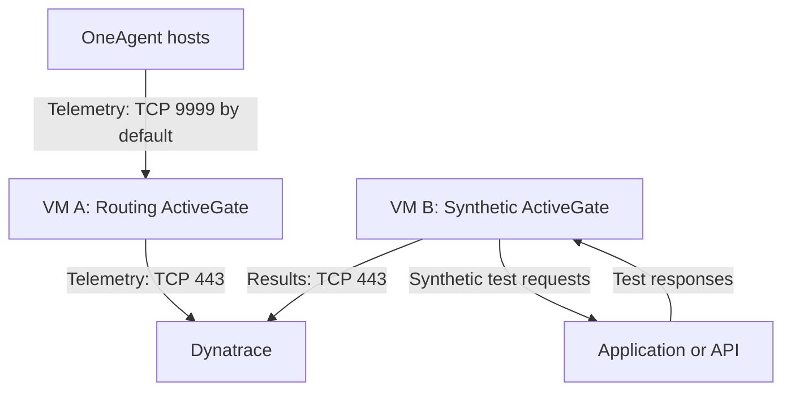

# Can Routing and Synthetic ActiveGates Run on the Same Windows Server? A Dynatrace Case Study

**Author:** Praveen Veerapogu  
**Website:** www.veerpedia.com  
**Experiment log date:** 21 October 2026  
**Tested ActiveGate version:** 1.347.49, build 1.347.49.20261014-002600

## The short answer

For the native Windows installation tested here, running a routing/monitoring ActiveGate and a Synthetic-enabled ActiveGate together in the same operating system is not a supported deployment. Dynatrace requires a clean installation for Synthetic monitoring; reusing an existing ActiveGate host requires uninstalling its current ActiveGate first. The Synthetic installation does not retain OneAgent-routing functionality. [1]

However, the exact failure recorded in this experiment needs a more specific explanation: **the installer detected an existing installation, entered maintenance mode, and rejected the `--set-group=default` parameter.**

That distinction matters. The captured error identifies why this attempt stopped; the official documentation establishes the supported architecture.

## 1. Why I performed this experiment

While planning a Dynatrace lab, I wanted to check whether one Windows Server could serve two purposes:

- Route OneAgent traffic and support cloud or extension monitoring.
- Execute Synthetic monitors from a private location.

Using one server might appear convenient for a small lab. I installed the routing/monitoring ActiveGate first, then attempted to install the Synthetic purpose on the same Windows operating system.

This case study explains the installation sequence, the actual failure, and the deployment approach engineers should use.

## 2. Lab environment

| Component | Configuration or evidence |
| --- | --- |
| Operating system | Windows Server, as recorded for the experiment |
| Windows build visible in screenshots | 10.0.26100.33650; the exact Server edition was not captured |
| CPU | 2 vCPU |
| RAM | 8 GB |
| Disk space | 30 GB reported; total capacity versus free space was not recorded |
| Network configuration | Ports 443 and 9999 reported enabled; rule direction and end-to-end connectivity were not independently captured |
| ActiveGate installer | 1.347.49.20261014-002600 |
| Installation privileges | Administrator command window |
| First purpose | Routing/monitoring |
| Second attempted purpose | Synthetic engine |
| Main diagnostic evidence | Six screenshots, one MSI log, and a connection properties file |

The successful first installation and its appearance in Dynatrace are my recorded observations. The supplied screenshot set shows installation in progress, but does not include the first installation's completion page or its Dynatrace UI entry.

## 3. Two purposes, rather than two independent products

“Type 1” and “Type 2” are convenient experiment labels. Dynatrace describes these choices as **ActiveGate purposes**.

| Purpose | Intended role |
| --- | --- |
| Routing/monitoring | Route OneAgent traffic and run supported cloud or remote-technology monitoring modules |
| Synthetic | Execute monitors from a private location |

Each purpose has its own module set. Dynatrace explicitly states that mixing modules between purposes is unsupported. [2]

The presence of an “Update capabilities” option therefore should not be interpreted as permission to combine these purposes.

## 4. Reconstructing the screenshot sequence

The order below is reconstructed from the wizard pages, visible commands, and the MSI log. It is a logical sequence, not a claim that screenshot capture timestamps were available.

| Order | Original screenshot | Recommended caption |
| --- | --- | --- |
| 1 | `installing environment AG.PNG` | Routing/monitoring ActiveGate installation waiting for additional capabilities to download. |
| 2 | `synthetic AG.PNG` | Reopening ActiveGate 1.347.49 after requesting Synthetic installation; the welcome page describes updating capabilities or removing the existing product. |
| 3 | `installing syntheticAG.PNG` | The installer presents maintenance options: Update capabilities or Remove. |
| 4 | `SyntheticAG2.PNG` | Ready to Install page before the attempted maintenance operation. |
| 5 | `synag3.PNG` | Maintenance validation rejects the supplied ActiveGate group parameter. |
| 6 | `synag4.PNG` | The setup wizard ends prematurely and offers access to the log. |

**Publication note:** Use only sanitized copies of these screenshots. The command-window backgrounds expose credential text; the installer dialogs are the useful evidence.

## 5. What happened during installation?

### Step 1: Install the routing/monitoring ActiveGate

I selected the purpose for routing OneAgent traffic, monitoring cloud environments, or monitoring remote technologies through extensions.

The first screenshot shows the installer waiting for additional capabilities. I subsequently observed the ActiveGate successfully installed and reporting in Dynatrace.

Registration confirms that the ActiveGate appeared in the environment. This experiment does not include evidence that a OneAgent data path, cloud integration, or extension was functionally tested.

*Insert screenshot 1 here.*

### Step 2: Attempt the Synthetic installation

I then launched the installer with Synthetic requested. The relevant settings visible in the command and confirmed in the log were:

```text
ENABLE_SYNTHETIC=true
--set-group=default
```

These are the relevant arguments from the failed attempt, not a recommended complete installation command.

The welcome page described updating capabilities or removing the existing ActiveGate. The next page offered **Update capabilities** and **Remove**.

*Insert screenshots 2 and 3 here.*

The MSI log confirms why this happened:

```text
Product registered: entering maintenance mode
```

The installer recognized an existing product instead of starting an independent second ActiveGate installation. It also read the installed version as:

```text
ReadOldVersion: installed AG version (version=1.347.49.20261014-002600)
```

### Step 3: Proceed to the configuration attempt

The next captured page was **Ready to Install**. The subsequent error appeared while the wizard displayed **Changing Dynatrace ActiveGate**.

*Insert screenshot 4 here.*

Although “Ready to Install” sounds like a new installation, the log had already established that this execution was in maintenance mode.

### Step 4: Encounter the actual error

The installer displayed:

> ERROR: Group cannot be specified for an update or maintenance. To proceed with the installation, remove the network zone parameter and restart the installation process.

*Insert screenshot 5 here.*

The message contains inconsistent wording: it identifies a **group** restriction but then refers to a **network zone** parameter.

The surrounding log is more precise:

```text
ADDITIONAL_CONFIGURATION is (--set-group=default)
Parsing (--set-group=default)
Found group in ADDITIONAL_CONFIGURATION
Extracted group as (default)
```

The evidence points to the supplied group parameter as the immediate validation failure. It does not establish a network-zone configuration problem.

Dynatrace's group documentation states that `--set-group` is an installation parameter that cannot be used during an ActiveGate update. It provides separate methods for changing the group after installation. [3]

### Step 5: Setup ends prematurely

The final screenshot shows the wizard reporting that setup ended prematurely.

*Insert screenshot 6 here.*

The log records:

```text
Action ended 15:56:08: ParseAdditionalConfiguration. Return value 3.
Action ended 15:56:08: INSTALL. Return value 3.
MainEngineThread is returning 1603
```

Microsoft defines 1603 as a fatal installation error. It is a general result code; in this case, the preceding group-validation message supplies the actionable explanation. [4]

The failed maintenance attempt does not prove that the original ActiveGate was removed. Its service and connectivity should be checked afterward.

## 6. What the log proves

Times below are reproduced from the server log. Its timezone was not established.

| Log time | Event | Meaning |
| --- | --- | --- |
| 15:52:14 | Existing product detected; maintenance mode entered | A registered ActiveGate installation was already present |
| 15:52:14 | Synthetic property set to true; group argument supplied | The attempted operation included both settings |
| 15:55:22 | Existing version read; group argument parsed | The installer evaluated the request against an installed product |
| 15:56:08 | Group restriction reported; configuration action failed | Immediate reason this execution stopped |
| 15:56:47 | Final reconfiguration status 1603 recorded | The maintenance operation failed |

The connection properties file contains server, tenant, and authentication settings. It is not proof that Synthetic was enabled, that both purposes could coexist, or that monitor execution succeeded. Its credential values are unnecessary for this analysis and are excluded.

## 7. Would removing the group parameter make both purposes work?

**It would not make this a supported combined deployment.**

Removing an argument that triggers validation and meeting Dynatrace's deployment requirements are separate issues. No retry without the group parameter was captured in this evidence set, so this article does not claim what the next installer screen would have shown.

The supported path for repurposing the host is to uninstall the existing ActiveGate and perform a clean installation for Synthetic monitoring. [1]

Also, the screenshots do not contain an explicit “uninstall the routing ActiveGate before installing Synthetic” error. They show a **Remove** maintenance option. The clean-install requirement comes from Dynatrace documentation.

## 8. Were the hardware specifications or ports responsible?

The recorded terminating error is a configuration-validation failure. The evidence does not identify insufficient CPU, RAM, disk space, or a port collision as its cause.

That does not establish that the server passed every Synthetic prerequisite.

For example, Dynatrace's current XS sizing guidance lists 2 vCPU, 4 GB RAM, and 20 GB free disk for a node with browser support, with a Windows recommendation of at least 8 GB RAM and 25 GB free disk. Available memory, disk IOPS, monitor workload, and OS support also matter. [5]

Therefore, “30 GB disk space” needs clarification: a 30 GB system disk is not the same as 30 GB free after Windows and other software are installed.

Networking must also be described directionally. By default, a routing ActiveGate receives OneAgent connections on TCP 9999 and connects to Dynatrace on TCP 443. [6] A Synthetic host also needs connectivity to its monitored targets and required download endpoints. [1] Simply enabling two ports does not validate the complete setup.

## 9. Recommended deployment

For simultaneous routing and private Synthetic monitoring, use separate hosts or separate VMs, each with its own operating system and resources.



This is the recommended design, not a deployment validated by this experiment.

Separate VMs on the same physical host are different from installing both purposes inside one Windows OS. They still share a physical failure domain.

If the existing server must be repurposed, my operational recommendation is to:

1. Identify OneAgents, extensions, and cloud-monitoring tasks depending on it.
2. Move required workloads to another suitable ActiveGate and verify continuity.
3. Uninstall the existing ActiveGate.
4. Check Synthetic prerequisites and perform a clean Synthetic installation.
5. Assign the node to a private location and execute a test monitor.

These are follow-up steps; an uninstall, clean reinstall, and successful monitor run were not captured in this experiment.

## 10. Lessons for Dynatrace engineers

- Choose the ActiveGate purpose before deployment.
- Recognize maintenance mode before treating an installer run as a second installation.
- Read the messages preceding error 1603 to identify the specific failure.
- Distinguish an installer argument error from a supported-architecture requirement.
- Validate actual data flow or monitor execution, beyond a successful installation or UI entry.
- Record free disk space, available memory, version, and network direction for reproducible labs.
- Sanitize screenshots and logs before sharing installation evidence.

The result of this case study is precise: **the attempted second installation entered maintenance mode and failed on the group parameter. Independently, Dynatrace's documented deployment model requires a clean, dedicated-purpose Synthetic installation.**

## References

Documentation checked on 21 October 2026.

1. [Dynatrace: Private Synthetic locations](https://docs.dynatrace.com/docs/observe/digital-experience/synthetic/synthetic-app/private-locations)
2. [Dynatrace: ActiveGate purposes and functionality](https://docs.dynatrace.com/docs/ingest-from/dynatrace-activegate/capabilities)
3. [Dynatrace: ActiveGate group](https://docs.dynatrace.com/docs/ingest-from/dynatrace-activegate/activegate-group)
4. [Microsoft: Windows Installer error codes](https://learn.microsoft.com/en-us/windows/win32/msi/error-codes)
5. [Dynatrace: Requirements for private Synthetic locations in Classic](https://docs.dynatrace.com/docs/observe/digital-experience/synthetic-monitoring/private-synthetic-locations/system-and-hardware-requirements-for-private-synthetic)
6. [Dynatrace: ActiveGate default installation settings for Windows](https://docs.dynatrace.com/docs/ingest-from/dynatrace-activegate/installation/windows/windows-default-settings)

---

## Editorial evidence notes — remove before publication

- Local source log: `installation_msiexec_20261021-155213.log`.
- Useful original log lines: 38–39 (maintenance mode), 61–62 (arguments), 1304 (installed version), 1326–1340 (parsing and failure), 1373 (final status).
- The screenshot order is reconstructed from UI progression and log evidence, not image timestamps.
- Do not publish the original connection properties file. It contains tenant and ActiveGate authentication credentials. Rotate/revoke exposed credentials through the appropriate Dynatrace controls, coordinating changes needed by active installations.
- The command-window backgrounds also expose download authorization token text. Rotate/revoke the affected credentials and crop to the wizard or redact these backgrounds before publishing screenshots.
- No sanitized image files are included in this Markdown deliverable. The image captions and insertion points identify where reviewed copies belong.
- The log contains an `Installed` property dated earlier than the captured run. Do not use that field alone to date the first installation; this case study dates only the supplied failed execution.
- Do not claim that removing `--set-group` was tested, that uninstallation occurred, or that Synthetic monitors ran successfully.

