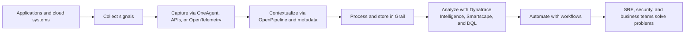
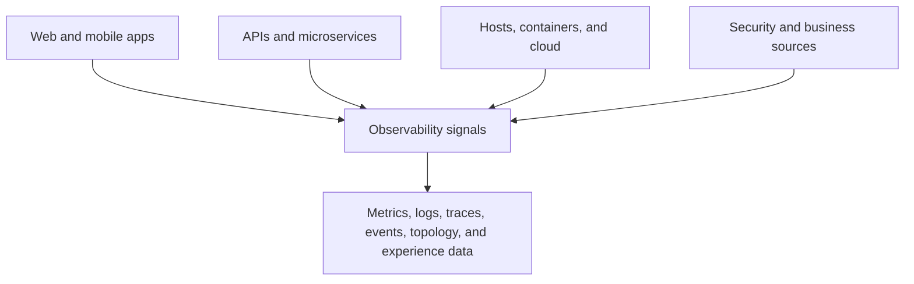
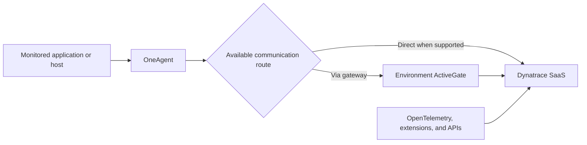
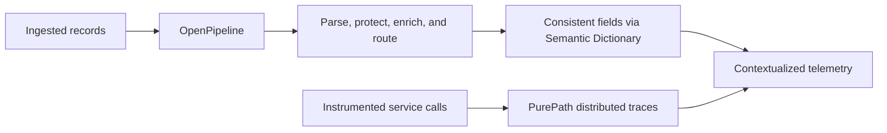
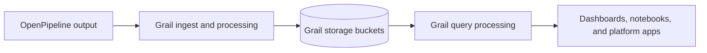
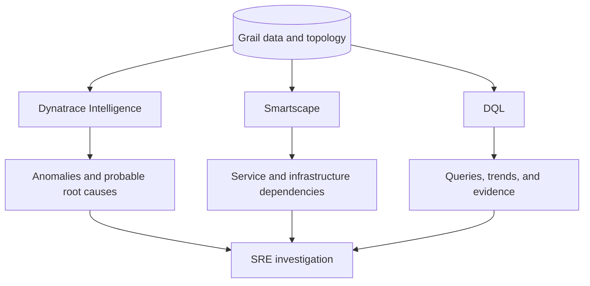
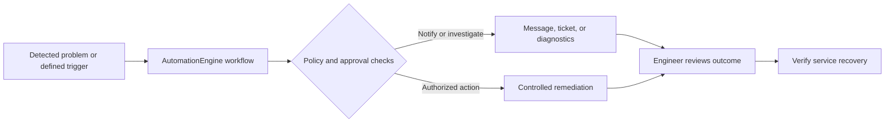
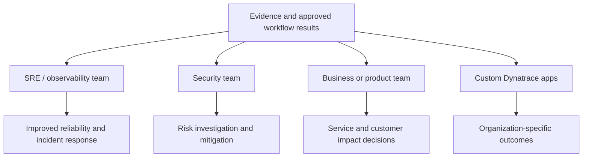
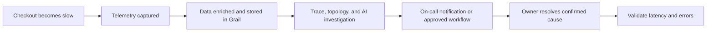

# Dynatrace Architecture Explained for SRE Interviews: 7 Stages, Components, and Workflow

**Author:** Praveen Veerapogu  
**Published by:** Veerpedia — www.veerpedia.com  
**Audience:** Site Reliability Engineers, Dynatrace Engineers, DevOps Engineers, Observability Engineers, and interview candidates

> **Architecture note:** This guide explains the **Latest Dynatrace platform** shown in the provided Dynatrace architecture graphic. The seven stages are a **conceptual model**, not seven separate servers or a mandatory packet-by-packet sequence. Product availability, naming, and configuration vary by deployment and licensing. The image uses **Davis AI**; newer documentation also describes these AI capabilities under **Dynatrace Intelligence**.

## What is Dynatrace architecture?

Dynatrace architecture describes how performance, reliability, security, and business data moves from monitored systems into insights that engineering teams can act on. For an SRE, the simplest way to remember the workflow is:

**Collect → Capture → Contextualize → Process → Analyze → Automate → Solve.**

An application might generate a slow API response, for example. Dynatrace can capture the relevant telemetry, connect it to the impacted service and dependencies, analyze the issue, and help the SRE investigate or trigger a configured workflow. This is why understanding the architecture is more useful in interviews than only memorizing component names.



## Step 1: Collect — Understand what monitored systems generate

Everything begins with the systems you're responsible for: web applications, APIs, microservices, hosts, Kubernetes workloads, cloud services, and user-facing applications. They produce data such as **metrics, logs, traces, topology information, user behavior, events, security signals, and business events**.

Think of a checkout API. Its response time is a metric; a Java exception is recorded in a log; the path across the checkout service, payment service, and database appears in a distributed trace. Dynatrace can bring these different views together when collection and instrumentation are configured appropriately.

**Interview takeaway:** Collection is about **which signals exist**. It is not the same as the method used to send them to Dynatrace.



## Step 2: Capture — Bring data into Dynatrace

Dynatrace supports multiple capture and ingestion approaches:

- **OneAgent** runs on monitored hosts or workloads, discovers processes, and gathers supported infrastructure and application telemetry. With appropriate monitoring configuration, it provides deep application visibility and automatic tracing.
- **OpenTelemetry** instruments applications and exports supported telemetry to Dynatrace through configured OTLP ingestion paths.
- **Dynatrace APIs and extensions** ingest additional observability, infrastructure, security, or business data.
- **Real User Monitoring (RUM)** captures browser or mobile user experience when instrumented; **Synthetic Monitoring** performs configured active checks.

An **Environment ActiveGate** can act as a communication endpoint between monitored environments and Dynatrace SaaS. It is useful for connectivity and selected monitoring use cases, but **OneAgent does not always require an ActiveGate**; supported direct connectivity is also possible.

**Interview takeaway:** OneAgent is primarily a monitoring/data-collection agent. ActiveGate is a gateway/connectivity component, **not** a replacement for OneAgent or the Grail database.



## Step 3: Contextualize — Turn raw data into usable information

Raw telemetry is hard to investigate without context. **OpenPipeline** supports ingestion routing and configured processing operations such as parsing fields, masking sensitive information, enrichment, data extraction, and assignment to storage buckets. The **Semantic Dictionary** provides consistent field names and meanings across data types.

**PurePath** is Dynatrace's distributed tracing capability. It links activities across a request so an SRE can follow a call through instrumented services. PurePath tracing is captured through instrumentation; it is **not** simply an OpenPipeline processor. These features complement one another: structured data provides meaning, while traces and topology provide relationships.

**Interview takeaway:** Context lets you move from “there are errors” to “these errors happened in a particular service, for this request path, during this time window.”



## Step 4: Process — Store and query with Grail

**Grail** is Dynatrace's unified data lakehouse for observability, security, and business data. According to Dynatrace documentation, its architecture separates **ingest and processing**, **storage**, and **query processing**. OpenPipeline routes processed data into Grail buckets; Grail then makes the stored records available for querying and analysis under the applicable permissions.

For SREs, the benefit is the ability to investigate logs, spans, events, and other supported data in a shared environment instead of manually comparing disconnected tools. Retention, permissions, access, and ingestion still depend on your environment's configuration.

**Interview takeaway:** Grail is the platform's storage and analytics foundation; OpenPipeline handles configurable data routing and preparation **before** storage.



## Step 5: Analyze — Investigate performance and root cause

Once telemetry and relationships are available, Dynatrace provides several ways to analyze them:

- **Dynatrace Intelligence / Davis AI:** anomaly detection, causal root-cause analysis, and predictive capabilities, depending on the enabled features and available signals.
- **Smartscape:** a dynamic topology view of monitored entities and their dependencies. **Smartscape on Grail** represents entities as nodes and relationships as edges.
- **DQL (Dynatrace Query Language):** a query language for exploring and transforming Grail data in dashboards, notebooks, and other supported interfaces.

A basic DQL investigation can count recorded error logs during the last 30 minutes:

```dql
fetch logs, from:now()-30m
| filter loglevel == "ERROR"
| summarize error_count = count()
```

The query counts **ingested logs marked ERROR**; it does not automatically equal the service's failed-request count. Log fields, available datasets, and access depend on the environment.

**Interview takeaway:** Dynatrace does not only display that a metric crossed a threshold; it can correlate available signals and dependencies to help narrow down a probable cause. Engineers should still validate the findings.



## Step 6: Automate — Convert findings into controlled actions

**AutomationEngine** powers Dynatrace workflows. Based on configured triggers and permissions, a workflow can notify the right team, create or update an incident through an integration, gather diagnostic information, or run approved remediation actions. **AppEngine** provides a way to build and run custom Dynatrace apps; it is a related platform capability, not simply an alert-delivery service.

A responsible SRE team starts with notifications and evidence collection. Any action that changes production—such as restarting a process or changing capacity—should follow predefined approvals, access controls, safeguards, and verification.

**Interview takeaway:** Dynatrace supports automation, but **automatic remediation does not happen by default**. Engineers define the triggers, integrations, decision rules, and permitted actions.



## Step 7: Solve — Put the insight in the hands of the right team

The final stage is the **consumer's outcome**, not a separate ingestion engine. SRE and observability teams use the information to protect reliability and user experience; security teams investigate exposure or threats; business teams understand service impact; and organizations can create tailored use cases with custom apps.

For example, an SRE may confirm that API latency is caused by slow database calls, involve the database owner, track recovery in service health views, and document corrective actions. Dynatrace can help connect the evidence, but the team's operational decisions still matter.

**Interview takeaway:** The architecture is valuable when data produces a **clear decision, faster diagnosis, or safer operational response**.



## End-to-end example: An e-commerce checkout API becomes slow

Imagine customers report that checkout takes eight seconds instead of two. Here's how to apply the architecture without guessing the cause:

1. **Collect:** The checkout application generates response-time metrics, traces, and logs.
2. **Capture:** OneAgent or configured OpenTelemetry instrumentation exports supported signals to Dynatrace.
3. **Contextualize:** The signals carry service identifiers and request relationships; configured OpenPipeline processing structures ingested records.
4. **Process:** Ingested data is stored in Grail and becomes available for authorized analysis.
5. **Analyze:** Dynatrace Intelligence, Smartscape, PurePath, and DQL help identify whether a downstream call, code path, or infrastructure dependency contributes to the slowdown.
6. **Automate:** A configured workflow can notify on-call staff, open an incident, and attach evidence. Production remediation requires the team's defined safeguards.
7. **Solve:** The owner fixes the confirmed issue, and the SRE verifies latency, errors, and user experience have returned to an acceptable level.



## Dynatrace architecture interview questions and answers

**1. How would you explain Dynatrace architecture in 60 seconds?**  
Dynatrace collects telemetry from applications, infrastructure, and digital experiences using components such as OneAgent, OpenTelemetry, extensions, and APIs. OpenPipeline handles configurable ingestion processing and contextual enrichment, while Grail stores and processes queries over the collected data. Dynatrace Intelligence analyzes anomalies and potential root causes, Smartscape shows dependencies, and DQL supports investigations. AutomationEngine can run defined workflows, helping SRE teams move from detection to resolution.

**2. What is the difference between OneAgent and ActiveGate?**  
OneAgent gathers monitoring data from supported workloads. Environment ActiveGate provides a communication path and supports certain monitoring/integration functions. OneAgent may connect through ActiveGate or directly to Dynatrace SaaS, depending on the deployment.

**3. What is Grail?**  
Grail is the Dynatrace data lakehouse and query foundation for supported observability, security, and business data. It is not the agent installed on the server.

**4. What does OpenPipeline do?**  
It routes and processes ingested data, including operations such as parsing, enrichment, masking, metric extraction, and bucket assignment where supported and configured.

**5. What is PurePath?**  
PurePath is Dynatrace's distributed tracing capability, allowing engineers to follow an instrumented request across connected services and identify latency or errors along the call path.

**6. What is the purpose of Smartscape?**  
Smartscape shows monitored entities and their relationships. SREs use it to understand dependencies, possible blast radius, and infrastructure connections.

**7. What is Davis AI or Dynatrace Intelligence?**  
It refers to Dynatrace's intelligence capabilities for anomaly detection, causal analysis, forecasting, and related AI-driven experiences. Capabilities vary by feature and configuration; it is not a guarantee of perfect root-cause identification.

**8. Can Dynatrace automatically fix production issues?**  
It can initiate remediation using workflows and integrations that teams deliberately configure and authorize. It does not safely or universally fix incidents without those controls.

**9. What is the difference between DQL and Grail?**  
Grail stores and serves queries over data. DQL is the language used to retrieve and analyze supported Grail data.

**10. Is the official seven-stage graphic a physical deployment diagram?**  
No. It explains platform capabilities as a logical pipeline. Network routes, gateway placement, supported telemetry, and app configuration depend on the actual environment.

## Final takeaway for SRE candidates

Do not memorize Dynatrace as a set of product names. Explain what happens during an incident: **where the signal comes from, how it reaches the platform, how the data gains context, where it can be queried, how you investigate, what you can automate, and how you verify recovery**. That sequence shows practical SRE understanding and makes your architecture answer easier for an interviewer to follow.

---

## SEO publishing details

- **SEO title:** Dynatrace Architecture Explained: 7 Steps for SRE Interviews
- **Suggested permalink:** `dynatrace-architecture-sre-interview-guide`
- **Meta description:** Learn Dynatrace architecture in 7 simple steps with Mermaid diagrams, OneAgent, Grail, Davis AI, OpenPipeline, and SRE interview questions.
- **Primary keyword:** Dynatrace architecture for SRE interviews
- **Secondary keywords:** Dynatrace architecture explained, Dynatrace OneAgent architecture, Dynatrace Grail, Dynatrace OpenPipeline, Dynatrace interview questions, Davis AI, Smartscape, DQL
- **Suggested tags:** Dynatrace, SRE, Observability, APM, Dynatrace Architecture, OneAgent, Grail, OpenPipeline, Dynatrace Intelligence, Interview Preparation
- **Suggested image alt text:** Dynatrace platform architecture showing Collect, Capture, Contextualize, Process, Analyze, Automate, and Solve stages

## Official Dynatrace references

The explanations above are original educational wording built around the supplied official platform graphic, with component behavior cross-checked against these Dynatrace documentation pages:

1. [Dynatrace platform overview](https://docs.dynatrace.com/docs/platform)
2. [How OneAgent works](https://docs.dynatrace.com/docs/platform/oneagent/how-one-agent-works)
3. [ActiveGate connectivity schemes](https://docs.dynatrace.com/docs/ingest-from/dynatrace-activegate/supported-connectivity-schemes-for-activegates)
4. [Ingest Grail data](https://docs.dynatrace.com/docs/platform/grail/dynatrace-grail/ingest-data)
5. [OpenPipeline data flow](https://docs.dynatrace.com/docs/platform/openpipeline/concepts/data-flow)
6. [Semantic Dictionary](https://docs.dynatrace.com/docs/semantic-dictionary)
7. [Grail architecture](https://docs.dynatrace.com/docs/platform/grail/dynatrace-grail/architecture)
8. [Smartscape on Grail](https://docs.dynatrace.com/docs/platform/grail/smartscape-on-grail)
9. [Dynatrace Intelligence root cause analysis](https://docs.dynatrace.com/docs/dynatrace-intelligence/root-cause-analysis)
10. [DQL reference](https://docs.dynatrace.com/docs/platform/grail/dynatrace-query-language/dql-reference)
11. [AutomationEngine](https://docs.dynatrace.com/docs/platform/automationengine)
12. [AppEngine](https://docs.dynatrace.com/docs/platform/appengine)

*Original educational article by Praveen Veerapogu for Veerpedia. Dynatrace and its product names belong to their respective owners. The architecture diagram provided as a source is Dynatrace material; this article does not claim ownership of it. No originality-detection or plagiarism-checker score is guaranteed.*
