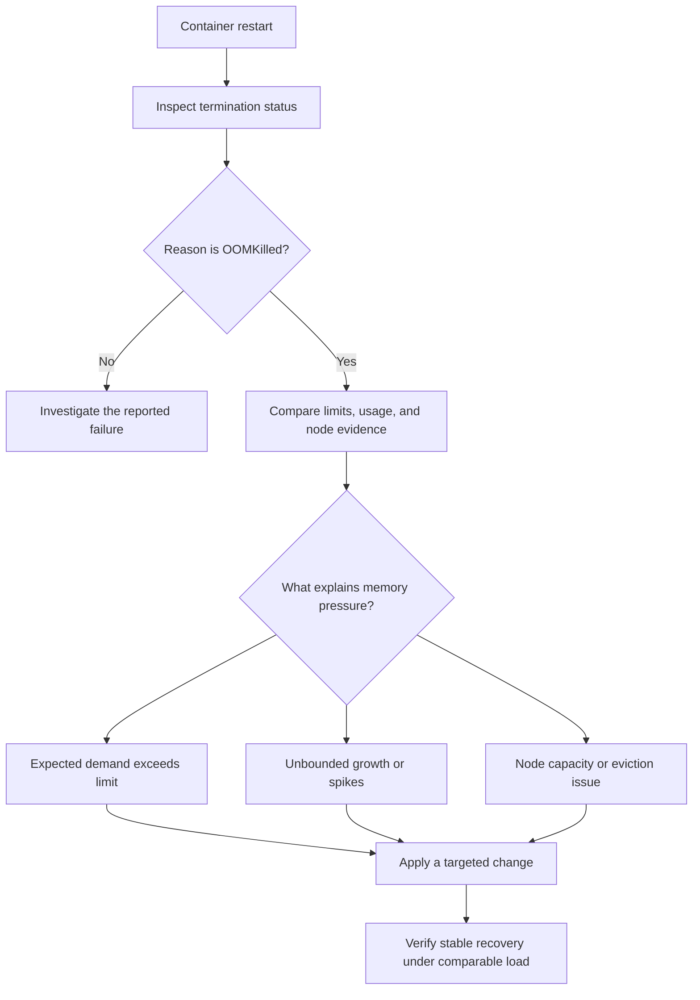

# Troubleshoot Kubernetes OOMKilled Errors with Dynatrace

**Author:** Praveen Veerapogu  
**Website:** [Veerpedia](https://www.veerpedia.com/)  
**Documentation reviewed:** 18 October 2026  
**Draft status:** Validate the demonstration in your Kubernetes cluster and add screenshots before publishing.

A container can restart because its process crashed, a probe failed, or the system terminated it. When Kubernetes reports `OOMKilled`, memory becomes the first area to investigate.

This guide shows how to confirm an out-of-memory termination with `kubectl`, examine the affected workload in Dynatrace, identify the likely cause, and verify a corrective change. The demonstration deliberately gives a small training container less memory than its bounded allocation requires.

The walkthrough uses Kubernetes status evidence and Dynatrace's Kubernetes screens. It does not depend on custom DQL.

## What does OOMKilled mean?

`OOMKilled` is a container termination reason associated with an out-of-memory kill. On Linux, the kernel enforces container memory limits through cgroups and can kill processes when memory cannot be satisfied within the applicable constraints. A container exceeding its limit is a common scenario; node-wide memory exhaustion can also require investigation. [1]

Keep these signals separate:

| Signal | What it tells you |
|---|---|
| `OOMKilled` | The container runtime reported an out-of-memory termination. Inspect container and node evidence to determine why. |
| Exit code `137` | Commonly indicates a SIGKILL termination. It is supporting evidence, not sufficient proof of OOM by itself. |
| `CrashLoopBackOff` | Kubernetes is delaying restarts after repeated failures. It describes restart behaviour, not the original cause. |
| `Evicted` | The Pod was evicted. Investigate the eviction reason and node conditions. |
| An application memory exception | The application or runtime encountered an allocation problem. Check whether the container actually terminated as `OOMKilled`. |

An OOM event commonly restarts the affected container inside the same Pod when its restart policy permits it. A Deployment rollout can create a replacement Pod instead. Do not treat every container restart as a new Pod. [2][3]

## Understand memory requests and limits

A memory **request** influences scheduling. A memory **limit** constrains how much memory the container can use under kernel enforcement. Using more than the request alone does not mean the container should be OOM killed. [1]

The lab uses these deliberately chosen settings:

| Setting | Failure configuration | Recovery configuration |
|---|---:|---:|
| Memory request | 64 MiB | 256 MiB |
| Memory limit | 128 MiB | 384 MiB |
| Target retained application buffers | 192 MiB | 192 MiB |
| Replicas | 1 | 1 |

The Python runtime and other process memory require space in addition to those buffers. The logged buffer size is not total container memory usage.

Raising the request alone would not fix the demonstrated 128 MiB limit. Raising a limit can resolve an undersized allocation, but a genuine memory leak requires an application-level investigation.

## Prerequisites

Use a non-production Linux Kubernetes cluster with enough spare capacity for this small workload and its monitoring components. You need:

- `kubectl` connected to the intended cluster and permission to create a dedicated namespace and Deployment.
- A lab node where the workload cannot use swap, such as Kubernetes `NoSwap` behaviour. Workload swap can change whether and when the allocation causes an OOM kill. [13]
- A cluster already visible in Dynatrace's Kubernetes app, with workload metrics and events being collected.
- Access to the relevant cluster, namespace, workloads, and containers in Dynatrace.
- Permission to pull the official `python:3.12-slim` image, or an approved equivalent from your registry.
- The companion lab files from this guide.

Dynatrace Kubernetes platform monitoring supplies infrastructure metrics and events. Application-level process, runtime, or profiling detail requires the corresponding observability setup and supported technology. Container log ingestion is also a separate prerequisite for seeing application logs inside Dynatrace; `kubectl logs` remains usable for this exercise. [4]

The screen walkthrough targets Dynatrace's current Kubernetes app. Kubernetes Classic has different navigation. Confirm your environment's app prerequisites and monitoring configuration before starting. [5]

## Step 1: Prepare the lab namespace

Check the active context before applying anything:

```bash
kubectl config current-context
kubectl get nodes
```

Use a dedicated namespace named `veerpedia-oom-lab`. Keep only this exercise in it, because the cleanup step deletes that namespace.

Save the following as `00-namespace.yaml`, or use the supplied file:

```yaml
apiVersion: v1
kind: Namespace
metadata:
  name: veerpedia-oom-lab
  labels:
    purpose: veerpedia-oom-demo
```

```bash
kubectl apply -f 00-namespace.yaml
```

Do not run this memory-failure exercise against a production application or a node that is already under memory pressure.

## Step 2: Deploy a container with an intentionally small memory limit

The demo waits for 60 seconds, then retains 8 MiB chunks roughly every ten seconds until it reaches a 192 MiB payload. It touches the allocated pages and keeps the buffers referenced.

With a 128 MiB limit, this is designed to trigger an OOM termination before reaching the payload target. The precise time and last printed allocation depend on runtime overhead and enforcement. This is a controlled capacity-mismatch demonstration, not a measured production incident or a simulated memory-leak diagnosis.

Save this as `01-oom-demo.yaml`:

```yaml
apiVersion: apps/v1
kind: Deployment
metadata:
  name: oom-demo
  namespace: veerpedia-oom-lab
spec:
  replicas: 1
  strategy:
    type: Recreate
  selector:
    matchLabels:
      app: oom-demo
  template:
    metadata:
      labels:
        app: oom-demo
    spec:
      automountServiceAccountToken: false
      nodeSelector:
        kubernetes.io/os: linux
      securityContext:
        runAsNonRoot: true
        runAsUser: 10001
        runAsGroup: 10001
        seccompProfile:
          type: RuntimeDefault
      containers:
      - name: memory-demo
        image: python:3.12-slim
        imagePullPolicy: IfNotPresent
        command:
        - python
        - -u
        - -B
        - -c
        args:
        - |
          import os
          import signal
          import time

          MIB = 1024 * 1024

          def setting(name, default, minimum, maximum):
              value = int(os.environ.get(name, str(default)))
              if not minimum <= value <= maximum:
                  raise ValueError(f"{name} must be between {minimum} and {maximum}")
              return value

          target = setting("TARGET_MIB", 192, 1, 512)
          chunk = setting("CHUNK_MIB", 8, 1, 64)
          warmup = setting("WARMUP_SECONDS", 60, 0, 600)
          interval = setting("INTERVAL_SECONDS", 10, 0, 60)
          hold = setting("HOLD_SECONDS", 0, 0, 3600)

          def stop(signum, frame):
              print("shutdown_requested", flush=True)
              raise SystemExit(0)

          signal.signal(signal.SIGTERM, stop)
          print(f"warmup_seconds={warmup} target_payload_mib={target}", flush=True)
          time.sleep(warmup)

          blocks = []
          allocated = 0
          while allocated < target:
              amount = min(chunk, target - allocated)
              buffer = bytearray(amount * MIB)
              # Write to each page so the exercise consumes resident memory.
              for offset in range(0, len(buffer), 4096):
                  buffer[offset] = 1
              blocks.append(buffer)
              allocated += amount
              print(f"payload_allocated_mib={allocated}", flush=True)
              if allocated < target:
                  time.sleep(interval)

          print(f"target_reached payload_allocated_mib={allocated}", flush=True)
          # Retain the buffers. A zero hold means keep running until the Pod is stopped.
          if hold:
              time.sleep(hold)
          else:
              while True:
                  time.sleep(30)
        securityContext:
          allowPrivilegeEscalation: false
          readOnlyRootFilesystem: true
          capabilities:
            drop:
            - ALL
        resources:
          requests:
            cpu: 100m
            memory: 64Mi
          limits:
            cpu: 500m
            memory: 128Mi
```

The Deployment uses `Recreate` so the lab does not temporarily run an old and new replica during the corrective rollout. This is a lab choice, not a general production rollout recommendation.

The image tag is mutable. Record the resolved image ID from your Pod details, and pin an approved digest when you need repeatable builds.

Check the manifest against your API server and admission policies:

```bash
kubectl apply --dry-run=server -f 01-oom-demo.yaml
```

If the dry run is rejected, resolve the reported policy, quota, image, or configuration issue before proceeding. Successful dry-run validation does not prove that the image will pull or the demo will OOM.

Apply the manifest:

```bash
kubectl apply -f 01-oom-demo.yaml
```

```bash
kubectl get pods -n veerpedia-oom-lab -l app=oom-demo -w
```

Press **Ctrl+C** to stop watching; this does not stop the Pod.

Initially, the Pod may display `Running` and `1/1`. The demo has no readiness probe, so that state is not evidence of sustained stability. Allow enough time for the allocation ramp and the first termination.

## Step 3: Confirm the actual termination reason

Inspect the Pod:

```bash
kubectl describe pods -n veerpedia-oom-lab -l app=oom-demo
```

Find the **memory-demo** container. Check its current or last termination state, exit code, restart count, and effective memory limit.

You may see fields resembling this illustrative excerpt:

```text
Last State:
  Terminated:
    Reason: OOMKilled
    Exit Code: 137
```

The formatting above is illustrative, not captured output from this preparation. Require an actual `OOMKilled` reason in your run.

While the container is terminated, the reason can be under its current `state.terminated`. After a restart, it commonly appears under `lastState.terminated`. The Pod API records the current state, last state, and restart count separately. [6]

Retrieve logs from the previous instance of the named container:

```bash
kubectl logs -n veerpedia-oom-lab -l app=oom-demo -c memory-demo --previous --timestamps --tail=50
```

The kernel can terminate a process without allowing it to print a final error. The last allocation message may therefore be the only application clue. A message reporting 112 MiB of buffers, for example, would not imply that total container usage was only 112 MiB.

If `--previous` reports that no previous container is available, wait for the first restart or inspect the current container logs. It also cannot retrieve a deleted Pod's history. [7]

Review events and save the Pod evidence before replacing it:

```bash
kubectl get events -n veerpedia-oom-lab --sort-by=.metadata.creationTimestamp
```

```bash
kubectl get pods -n veerpedia-oom-lab -l app=oom-demo -o yaml > oom-pod-before.yaml
```

Events may include `BackOff`, `Created`, or `Started`. A literal Kubernetes Event with reason `OOMKilled` is not required; container termination status is the primary confirmation.

The event command sorts by object creation time. Repeated events can be grouped, so inspect their displayed occurrence times and counts too.

## Step 4: Investigate the workload in Dynatrace

Open the Kubernetes app and select the monitored cluster. Locate namespace `veerpedia-oom-lab` and workload `oom-demo`.

Use the workload's health view to look for OOM indicators and restarts. Review **Utilization** for memory behaviour, then **Events** for related lifecycle activity. Where available, drill down to the affected Pod and the **memory-demo** container. Dynatrace documents this health, utilization, and event workflow. [8]

Capture these observations:

| Evidence | Investigation question |
|---|---|
| Effective container memory limit | Is the running Pod really using the intended 128 MiB limit? |
| Memory trend | Does usage grow before the termination? |
| Restart and OOM indicators | Do they line up with Kubernetes termination timestamps? |
| Container identity | Is memory-demo affected, or is the failure in a different container? |
| Event details | What happened around the restart? |
| Selected timeframe | Does the view cover the actual failure, including ingestion delay? |

Keep the same timeframe across your screenshots. If metrics or events are absent, check cluster monitoring, permissions, collection scope, and ingestion delay before interpreting an empty chart.

A memory chart does not have to show exactly 100% immediately before the kill. Collection intervals can miss a brief peak, and working-set memory is not identical to every memory quantity considered in cgroup accounting. The termination status remains important evidence.

Also avoid drawing a container conclusion from a workload average alone. Multiple containers or replicas can hide an individual limit breach.

## Step 5: Check whether the node is also under pressure

Get the node hosting the Pod:

```bash
kubectl get pods -n veerpedia-oom-lab -l app=oom-demo -o wide
```

Replace `NODE_NAME` below with the actual node name:

```bash
kubectl describe node NODE_NAME
```

Review the node's `MemoryPressure` condition, memory capacity and allocatable values, and relevant events. Compare that information with the node memory view in Dynatrace.

A current `MemoryPressure=False` value does not reconstruct every moment of an earlier incident. Use the timeline and, when needed, node-level kernel or runtime evidence to distinguish a container-limit OOM from a node-wide OOM.

Node-pressure eviction is a separate mechanism: kubelet can evict Pods to recover resources. An evicted Pod should be investigated using its eviction message and node conditions, rather than automatically treated as this container-limit lab scenario. [3]

If Metrics Server is installed, this optional command provides a current snapshot:

```bash
kubectl top pods -n veerpedia-oom-lab --containers
```

It is not historical evidence and may miss the pre-kill peak. Failure of `kubectl top` alone does not mean Dynatrace monitoring is broken.

## Step 6: Choose a fix that matches the evidence

| Observed pattern | Appropriate next action |
|---|---|
| Expected, bounded memory demand exceeds the limit | Right-size requests and limits after checking workload needs and node capacity. |
| Memory grows continually under comparable load | Investigate retained objects, caches, queues, buffers, and possible leaks. |
| Spikes correlate with large requests or batches | Bound payloads, batch size, and concurrency; consider streaming and backpressure. |
| A sidecar is the terminated container | Investigate and size that container independently. |
| Node-wide pressure or evictions occur | Review node capacity, scheduling requests, placement, and competing workloads. |
| Runtime heap settings consume nearly all container memory | Leave room for native memory and other process overhead; validate under load. |

For this exercise, the cause is intentionally known: a bounded payload larger than the container's configured limit. The supplied `02-oom-demo-fixed.yaml` keeps the same program and replica count, and changes only the memory request and limit:

```yaml
resources:
  requests:
    cpu: 100m
    memory: 256Mi
  limits:
    cpu: 500m
    memory: 384Mi
```

The snippet shows only the changed resource block. Apply the complete supplied recovery manifest, or copy the original manifest and replace its resource block while keeping the same name and namespace.

Validate and apply it:

```bash
kubectl apply --dry-run=server -f 02-oom-demo-fixed.yaml
```

```bash
kubectl apply -f 02-oom-demo-fixed.yaml
```

```bash
kubectl rollout status deployment/oom-demo -n veerpedia-oom-lab --timeout=180s
```

This updates the Deployment's Pod template and creates a replacement Pod. Capture failure evidence before the rollout.

A successful rollout reports controller readiness; it does not demonstrate that the program survived its later memory ramp. Continue with the next step.

## Step 7: Verify recovery beyond the initial Running state

Review the new Pod and its logs:

```bash
kubectl get pods -n veerpedia-oom-lab -l app=oom-demo
```

```bash
kubectl logs -n veerpedia-oom-lab -l app=oom-demo -c memory-demo --timestamps --tail=50
```

With the default demo timing, reaching the target takes about five minutes after the program starts. Look for the actual message:

`target_reached payload_allocated_mib=192`

Then observe the same new Pod for at least another three minutes:

- Its restart count should remain unchanged.
- No new `OOMKilled` termination should appear.
- The program should retain its buffers and remain running.
- Dynatrace should show the corresponding stable memory period, once telemetry arrives.
- The running container should have the intended 384 MiB limit.

This short observation is sufficient for the bounded exercise, not proof of long-term production reliability. In a real application, repeat representative load and verify user-facing availability and latency too.

A new Pod starting with zero restarts is expected after replacement and is not, by itself, proof of recovery. Compare failure and recovery windows while keeping the workload identity clear.

Use this table to record your actual run:

| Measurement | Before change | After change |
|---|---|---|
| Pod name and container | Record observed values | Record new values |
| Effective memory request / limit | Verify 64 MiB / 128 MiB | Verify 256 MiB / 384 MiB |
| Termination reason | Record actual reason | Record whether any new termination occurs |
| Restart count at start and end | Record both | Record both |
| Highest observed memory value and chart unit | Record value | Record value |
| Payload target reached | Record actual result | Confirm the log message |
| Observation window | Record timestamps | Record timestamps |

## Step 8: Review alerting

Dynatrace documents Kubernetes detection for out-of-memory kills, container restarts, memory saturation, and node conditions. Review their effective configuration for the cluster and workload. [9]

A warning signal, a problem, and a routed notification are different outcomes. The current Kubernetes alerting reference classifies OOM detection as an event-based warning signal; do not promise that every isolated OOM immediately opens a problem or sends an email.

Pair OOM detection with appropriate restart, memory, and service-impact monitoring. Tune thresholds and durations to the workload, and test notification routing separately if your article includes an alert demonstration.

## Troubleshooting flow



## How to demonstrate this clearly

Allow approximately 15–20 minutes for the live lab, including allocation ramps and telemetry arrival. Edit the recording into a focused 7–10 minute walkthrough.

| Segment | Show | Explain |
|---|---|---|
| Introduce the exercise | Resource block and bounded payload target | The workload intentionally needs more than its initial limit. |
| Confirm the failure | Container termination reason and previous logs | Why the evidence supports OOM and why exit code alone is insufficient. |
| Investigate in Dynatrace | Memory, restarts, OOM indicators, and events | How the timeline connects utilization with termination. |
| Check the node | Pod placement and node conditions | Why container limits and node pressure are different questions. |
| Apply the correction | Memory-only manifest change | Why this change addresses this specific capacity mismatch. |
| Validate recovery | Target-reached log, unchanged restart count, stable chart | Why an initial Running status is not enough. |

Capture six screenshots from your own run: initial memory settings, the OOM termination, Dynatrace workload health, memory utilization, relevant events, and recovery evidence. Keep cluster, namespace, workload, container, timeframe, and units readable.

Explain that this is a controlled training workload. Do not describe the allocation program as a real memory leak, and do not publish expected values as measurements.

## Common issues during the lab

| Issue | What to check |
|---|---|
| Pod stays Pending | Node capacity, namespace quotas, admission policies, and the Linux node selector. |
| ImagePullBackOff | Registry access, image policy, rate limits, and the configured image. |
| It has not OOM killed yet | Wait through warmup and ramp; verify the effective limit, allocation progress, and that the workload cannot use swap. |
| Exit code is different or Python raises MemoryError | Inspect the real termination details and runtime constraints; do not relabel it as a confirmed kernel OOM. |
| Dynatrace does not show the workload | Cluster monitoring, namespace scope, permissions, and discovery delay. |
| OOM is confirmed but no problem or notification appears | Signal classification, detection configuration, duration, and routing. |
| Recovery Pod restarts | Confirm the applied manifest, effective limits, image behaviour, other containers, and node conditions. |
| The memory chart lacks the final spike | Collection resolution and metric definition; use termination status and timestamps as additional evidence. |

## Frequently asked questions

### Is CrashLoopBackOff the same as OOMKilled?

No. CrashLoopBackOff describes delayed restart attempts. OOMKilled is one possible termination reason behind those restarts. Check the affected container's state. [2]

### Can a container use more memory than its request?

Yes. A request is used for scheduling and is not the container's memory cap. The applicable limit and system memory conditions determine enforcement. [1]

### Will increasing the memory limit always solve the problem?

No. It can correct an undersized limit, as intended in this lab. A leak, unbounded queue, problematic batch, or node-wide capacity issue needs a corresponding fix.

### Does every OOM termination produce an application error log?

No. An abrupt kill may prevent the application from writing a final message. Preserve container status, prior logs when available, and monitoring history.

### Can I reproduce this only in Dynatrace Playground?

The real OOM event requires a Kubernetes workload running in a cluster you control. Playground can help explore existing data, but this exercise needs your own lab cluster and its monitoring connection.

## Cleanup

Delete the demo after collecting your evidence:

```bash
kubectl delete deployment oom-demo -n veerpedia-oom-lab
kubectl delete namespace veerpedia-oom-lab
```

The namespace deletion removes every resource inside that dedicated namespace. Do not reuse it for unrelated work before cleanup.

## Official references

1. [Kubernetes resource management](https://kubernetes.io/docs/concepts/configuration/manage-resources-containers/)
2. [Kubernetes Pod lifecycle](https://kubernetes.io/docs/concepts/workloads/pods/pod-lifecycle/)
3. [Kubernetes node-pressure eviction](https://kubernetes.io/docs/concepts/scheduling-eviction/node-pressure-eviction/)
4. [Dynatrace Kubernetes deployment options](https://docs.dynatrace.com/docs/ingest-from/setup-on-k8s/deployment)
5. [Dynatrace Kubernetes app](https://docs.dynatrace.com/docs/observe/infrastructure-observability/kubernetes-app)
6. [Kubernetes Pod API and container status](https://kubernetes.io/docs/reference/kubernetes-api/core/pod-v1/)
7. [kubectl logs reference](https://kubernetes.io/docs/reference/kubectl/generated/kubectl_logs/)
8. [Troubleshoot Kubernetes workload health in Dynatrace](https://docs.dynatrace.com/docs/observe/infrastructure-observability/kubernetes-app/use-cases/troubleshoot-health-problems)
9. [Dynatrace Kubernetes alerting](https://docs.dynatrace.com/docs/observe/infrastructure-observability/kubernetes-app/reference/kubernetes-alerting)
10. [Kubernetes memory request and limit exercise](https://kubernetes.io/docs/tasks/configure-pod-container/assign-memory-resource/)
11. [Official Python container image](https://hub.docker.com/_/python)
12. [kubectl get reference](https://kubernetes.io/docs/reference/kubectl/generated/kubectl_get/)
13. [Kubernetes swap memory management](https://kubernetes.io/docs/concepts/cluster-administration/swap-memory-management/)

---

## Publishing notes

- **SEO title:** Troubleshoot Kubernetes OOMKilled Errors with Dynatrace
- **Suggested slug:** `kubernetes-oomkilled-troubleshooting-dynatrace`
- **Meta description:** Troubleshoot Kubernetes OOMKilled errors with Dynatrace. Verify container status, compare memory limits, reproduce an OOM, and validate recovery.
- **Primary phrase:** Kubernetes OOMKilled Dynatrace
- **Supporting phrases:** Kubernetes OOMKilled troubleshooting, container memory limits, Kubernetes exit code 137
- **Labels:** Kubernetes, Dynatrace, SRE, Observability, Troubleshooting
- **Featured image text:** Kubernetes OOMKilled — Diagnose, Fix & Verify
- **Suggested internal link:** [How to Implement Observability and APM](https://www.veerpedia.com/2026/10/how-to-implement-observability-apm.html)

Before publishing, replace the draft-status line with the actual tested date and environment, attach or host the companion files, and insert your own screenshots. Remove these publishing notes from the public article body.

**Preparation validation:** the YAML was parsed and checked for consistent selectors, resource changes, and embedded code. The exact embedded Python program was smoke-tested locally with a reduced 8 MiB payload. No Kubernetes API server, container runtime, or Dynatrace tenant was available here; admission, image execution, OOM termination, and Dynatrace results require your lab run.
